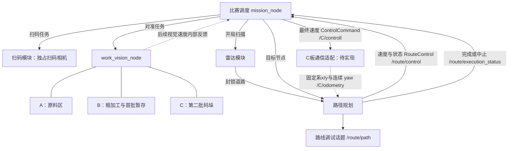

> 2026-10-25 当前底盘接口：左x/前y，七字段二维反馈、会话重置、50ms输入超时、自动恢复；见 [改造计划](docs/C板通信与二维里程反馈改造计划.md)。下文早期“板间通信待实现”等状态以本轮实施记录为准。

# 智能搬运机器人 ROS2 项目总体架构与开发指南

> 2026-10-22 实车目录清理：开发测试、临时文件、性能检查脚本、模拟节点和模拟启动入口已删除。下文模拟与测试内容保留为历史设计依据，不代表当前可用入口；当前运行方式以各包README为准。比赛起点与最终停车区统一在mission.yaml设置start_area / finish_area，历史相机检查结论归入docs/相机检查记录。

> 2026-10-22 速度出口更新：mission只发目标节点，起点及当前朝向仍由路径节点确定。路径节点通过 `/route/control`（RouteControl）返回速度、执行状态及任务身份，mission校验后独占发布 `/C/controll`（ControlCommand）；C板通信只读取mission最终输出。导航完成、中止、暂停或反馈超时均清除旧速度并归零。后续视觉速度也须经mission按阶段转发。

> 2026-10-22 比赛调度更新：已实现 `agv_mission`、整批任务Action契约、全模拟十五阶段、开始/暂停/复位服务及阶段日志；路径节点新增运行查询、停止、跨轮复位、任务及地图身份隔离。暂停不续跑，必须人工恢复现场并软件复位；首版故障不自主恢复。实际用法见[比赛调度说明](ros2_ws/src/agv_mission/README.md)，详细方案见[比赛调度节点设计方案](docs/比赛调度节点设计方案.md)。下文旧异常恢复描述以本次确认更新为准。主相机区域业务、雷达算法和C板桥接仍待实现，模拟结果不表示实车搬运已完成。

> 2026-10-20 主相机方案更新：后续实现请先读[主相机方案索引](docs/主相机视觉方案/README.md)、[粗加工详细规格](docs/主相机视觉方案/02_粗加工区放料与取回方案.md)及[自查记录](docs/主相机视觉方案/方案自查与开源复核记录.md)。三个逻辑模块改为原料、粗加工、暂存，共享一个主相机节点；主相机统一720p，物料先用HSV，动作话题预留0采、1平放、2码垛及对应完成反馈，完整机构动作与后续转仓全部交给C板。板间通信先同步当前区域并确认，C板据此区分0的原料/地面取料高度。调度发起一次整批，区域执行器顺序执行，调度不重复发采放命令。粗加工离站前必须用三空圆环平均点控制vx/vy、拟合线角控制omega完成精校准。本文下方旧A/B/C分组、YOLO优先和回中候选描述不再覆盖这些最新决定；阶段编号与路线规划仍沿用。当前二维局部返回、板间通信和主相机业务仍待实现。

> 版本：v2.4｜日期：2026-10-17｜目标：2027 年智能搬运赛项初赛
>
> 保留扫码、三个主摄像头视觉模块、开局雷达扫描、路径规划、比赛调度；区域间保持车头朝向，通过前后左右平移执行路线，抵达作业区域后才按需转向面对工作区。
> 路径规划节点已可根据固定系x/y和连续 yaw 反馈执行路线，并向 `/route/control` 返回速度，由mission转发到 `/C/controll`。板间通信节点、C板反馈接入和真实抓放编排仍待实现。
> 文中大部分其他包、节点、接口、启动文件及命令为设计约定。当前已实现扫码原型，以及 `agv_interfaces` / `agv_planning` 的路线规划和速度执行；实际用法见 [路径规划说明](ros2_ws/src/agv_planning/README.md)。本文不展开安装教程、模型部署、雷达算法和底盘电机控制。

## 1. 方案评价与当前边界

你的方案可行，建议采用：**ROS2 + 模块化代码 + 比赛状态机 + 视觉任务局部状态机**。

保留 `s=1…15` 的阶段编号。扫码和三个主摄像头模块分别具有独立任务入口，调试时绕开比赛调度直接调用。节点提前启动并待命，由调度器发送具体任务，不通过反复启动、关闭进程安排比赛顺序。

需要明确三个边界：

1. **路径规划同时执行路线。** 调度器按阶段发目标节点，规划器内部确定起点与当前朝向，结合封锁道路发布路线和离散行动链用于调试，并从固定系x/y、连续 yaw 反馈计算速度，通过 `/route/control` 返回mission，再由mission统一发布 `/C/controll`。
2. **路线发布不代表车辆到达。** `/route/path` 是计划调试信息；对应 `request_id` 在 `/route/execution_status` 收到 `COMPLETED` 才表示路径动作完成。当前 C 板板间通信节点尚未接入。
3. **视觉结果按任务区分。** 扫码区默认只读码，任务码校验通过即可完成扫码。主摄像头的像素对准成功不证明已经抓放；原料以后还须满足停稳条件才允许进入抓取步骤。真实动作以后补入。

### 1.1 已确认前提

| 项目 | 方案 |
|---|---|
| 上位机 | 地瓜派 RDK X5，8 GB，Ubuntu 22.04 |
| 框架 | ROS2；建议以 Humble 为首版基线，安装时确认镜像及驱动兼容性 |
| 下位机 | 大疆 C 板；串口/CAN 等传输方式待定 |
| 底盘 | 麦轮；轮式里程计 + IMU，计算位置待定 |
| 区域间移动 | 保持本段开始时的车头朝向，使用前进、后退、左移、右移走到相邻节点；路线拐角不转头 |
| 工位转向 | 抵达需要作业的区域后，按作业朝向执行左转/右转90°；转向标识保留 |
| 区域间完成判据 | C板执行当前离散动作后向X5回传对应完成标识 |
| 区域内对准判据 | X5判断有效目标像素误差合格，归零并完成视觉任务，不等待C板完成标识 |
| 方向状态 | 相对于地图的上、右、下、左；初始朝向赛前配置，之后按实际动作完成反馈更新 |
| 相机 | 两个固定 USB 摄像头：扫码相机、主摄像头 |
| 主摄像头算法 | 圆圈以霍夫圆为主，物料以 YOLOv8 为主 |
| 当前速度控制对象 | 全部为底盘，不把当前输出解释为龙门架速度 |
| 底盘速度出口 | `/C/controll`；保留指定的 `controll` 拼写 |
| 雷达 | 开局扫描一次，获取封锁道路后收回；具体实现暂不讨论 |
| 调试入口 | 电脑命令；无需执行地点间移动 |
| 异常策略 | 不自动跳过阶段，不因重试次数耗尽自行结束整场任务 |
| 本轮结束 | s=15真实完成后停车并保持结束状态；后续显示屏、按键和复位接口预留 |

### 1.2 当前版本与完整比赛

当前可以完成：视觉识别与对准、封锁边接口、3×3 路线规划与里程计闭环速度执行、15 阶段调度和模拟联调。板间通信、雷达算法及真实抓放仍待接入。

完整实车比赛仍需：路线执行及到达反馈，抓放与入仓动作，以及相应完成确认。当前对准原型或模拟全流程不能标记为已经完成真实搬运。

## 2. 模块与运行节点

### 2.1 按你的设想划分逻辑模块

| 模块 | 职责 | 当前输出 |
|---|---|---|
| 扫码 | 默认只解码和校验；保留可选的二维码相对对准调试 | 有效任务码；仅可选对准模式输出底盘速度 |
| A：原料区 | 第一、二批原料目标检测与对准 | 目标反馈、底盘速度、对准结果 |
| B：粗加工与首批暂存 | 粗加工放料/取料目标、第一次暂存放料目标的检测与对准 | 同上，以参数区分操作与工位 |
| C：第二批码垛 | 第二次暂存作业目标检测与对准 | 同上，携带同颜色第一层目标信息 |
| 雷达 | 开局扫描，给出被封锁的无向道路 | 封锁边列表、扫描状态 |
| 路径规划与执行 | 根据起终点、当前朝向和封锁道路规划，按累计路程及 yaw 反馈执行 | 路线调试消息、执行状态、自定义速度 |
| 比赛调度 | 保存 s、阶段子步骤和比赛上下文，选择任务与参数，处理结果 | 阶段状态、任务调用、已确认节点及朝向 |

“取料”“放料”“码垛”是业务名称。当前模块执行到对准为止，结果写成 `aligned`，不返回未经确认的 `picked`、`placed`。

### 2.2 独立调试不要求每个模块独立成进程

推荐首版运行节点如下：

| 节点 | 内部内容 | 资源归属 |
|---|---|---|
| `qr_task_node` | 扫码、解析；可选相对对准 | 独占扫码相机 |
| `work_vision_node` | A/B/C 三个独立任务类，公共检测与对准代码 | 独占主摄像头，共享一份 YOLO 模型 |
| `lidar_task_node` | 开局扫描；可先用模拟结果 | 雷达接入细节待定 |
| `route_planner_node` | 拓扑图、封锁边、规划、里程计执行及速度计算 | `/route/control` 内部反馈 |
| `mission_node` | 比赛状态机、上下文及速度转发 | 唯一比赛调度入口及 `/C/controll` 发布者 |

A/B/C 分别有独立文件、入口、配置和局部状态机，可以逐项调试。放在同一个主摄像头节点中，是为了避免三个进程抢占相机、重复加载 YOLO。**可独立调用的任务接口，才是独立调试的关键。**

如果以后需要拆成三个节点，再改为共享图像源和推理服务；当前无需增加这些节点。



### 2.3 不强制设置独立通信节点

当前只发布 `/C/controll`，用电脑订阅查看输出，不连接 C 板，也足以完成本阶段开发。

实际控制底盘时，仍需有接收方把 ROS2 速度消息交给 C 板。话题本身不会变成串口或 CAN 帧。接收适配可放进已有驱动或其他程序，**不强制单独建通信包或节点**。其部署位置与协议继续待定。

## 3. 3×3 拓扑地图与路线

### 3.1 编号与区域

```text
7 ─── 4 ─── 1
│     │     │
8 ─── 5 ─── 2
│     │     │
9 ─── 6 ─── 3
```

| 区域 | 节点 |
|---|---|
| 启停区 | mission YAML中的start_area和finish_area分别指定起点与最终停车区，left为1、right为3 |
| 二维码区 | 2 |
| 原料区 | 4 |
| 粗加工区 | 6 |
| 暂存区 | 8 |

只允许上下左右连接，无对角边。基础无向边共 12 条：

```text
(7,4) (4,1) (8,5) (5,2) (9,6) (6,3)
(7,8) (8,9) (4,5) (5,6) (1,2) (2,3)
```

初始默认边长 1200 mm，允许按路段分别标定。这个值是拓扑名义长度，不表示已经验证底盘可精确停到作业姿态。主摄像头区域按任务做相对目标对准；扫码区默认只读码，不用二维码位置修正地图位姿。

### 3.1.1 当前朝向与工位要求朝向

地图方向约定为 `UP / RIGHT / DOWN / LEFT`，对应图中上、右、下、左；这是地图方向，不是相机图像方向。沿顺时针排列为 `UP → RIGHT → DOWN → LEFT → UP`。

车辆状态是 `(current_node, current_heading)`。朝向是车辆当前状态，不能给每个节点写死一个“当前朝向”；同一个节点可以从不同方向进入。启动区配置为 `start_area: left/right`：面向二维码板时左侧为节点1，右侧为节点3；二者初始车头均朝向通往节点2的道路。规划器从连续 yaw 变化维护朝向。另为工位配置 `work_heading`，表示扫码或作业时固定相机需要面向的方向；扫码取消位置精校准后，仍应面向二维码板。

到达作业节点后，先按 `work_heading` 完成必要转向并停车，再交给视觉任务。离开工位前先恢复离站参考，随后保持当前车头朝向，通过前后左右平移执行下一条路线；不因路线拐弯而转头，也不默认先转回某个统一行驶朝向。若起终点相同但工位作业朝向不符，也可能仍需要转向，不能只凭 `[start]` 判断全部移动任务已完成。

初始区域由 YAML 指定。首次里程计 yaw 建立角度基准，转向完成后按连续 yaw 维护朝向；规划请求只能在计划执行完成后推进已知节点。

### 3.2 封锁边与规划

雷达输出例如 `[(2,5), (4,5)]`，表示对应道路不可走。封锁 `(2,5)` 同时禁止 `2→5` 和 `5→2`。内部用较小编号在前的统一边键，避免方向不同产生两条记录。

开局提交本轮扫描结果后，后续规划都使用这份道路状态。当前不引入持续雷达定位或动态避障。

```text
调度器：根据 s 确定 start、goal
规划器：排除封锁边，生成调试路线和行动链
路线执行器：合并连续同类动作，按累计路程/yaw反馈发速度，并报告完成或中止
板间通信适配：订阅速度并向C板转发；节点和协议待接入
```

接口用整数数组 `[1,2,5,8]`；调试显示可写成 `1258`，程序不使用拼接字符串。

规划依次最小化**总路程、移动方向变化次数**，完全同分时按节点序列字典序固定选择。首版采用小规模 Dijkstra，状态是“当前节点、上一步地图运动方向”，按毫米边长计算路程；不能只保留每个节点的一条最优记录，否则可能丢失后续方向变化更少的路线。

例如 `7896` 与 `7856` 都是三条默认等长道路，前者移动方向变化一次，后者两次，因此前者更优。全通地图上的 `7456` 同样只有一次变化，完全同分时固定选 `7456`；封锁7↔4后选 `7896`。第一步不计方向变化，工位原地转动车头不计入这个优化指标。

### 3.3 路线话题

指定路线话题：`/route/path`。建议自定义 `RoutePlan` 消息：

| 字段 | 含义 |
|---|---|
| `request_id` | 这一次规划的身份，同阶段重试也生成新身份 |
| `stage` | 请求时的 s |
| `start`、`goal` | 起终点 |
| `status` | `ok` / `no_path` / `invalid_request` |
| `nodes` | 完整节点数组，含起点与终点 |
| `map_revision` | 使用哪一版封锁道路 |

当前 `RoutePlan` 还包含 `actions`（逐边平移及终点作业转向）、`reason`、`total_distance_mm`、`direction_changes`、`start_heading`、`end_heading`。节点数组和行动链在同一条消息发布，仅供调试；Service返回同一份计划。执行状态由 `/route/execution_status` 单独报告。失败状态包括地图未就绪、里程计未就绪或无效、执行占用等，所有失败结果的路线数组为空。完整字段与请求约定见路径规划包说明。

无路返回 `no_path` 和空数组，不解释为已到达。合法且起终点相同，返回 `[start]`。

不把节点编号硬塞进表示空间位姿序列的 `nav_msgs/Path`。未来需要空间坐标时，再由执行侧转换。

### 3.4 路线发布后怎样处理

移动阶段发起路线后进入 `WAIT_ARRIVAL`：**调度器不因路线消息发布而更新当前位置或自动推进 s**。规划执行节点完成所有动作并报告对应 `request_id` 的 `COMPLETED` 后，调度器才可提交已到达状态。

- 单测规划：观察路线调试话题与行动链。
- 验证完整调度：在 `mission_mock` 模式接模拟执行状态，带当前 `request_id`。
- 当前路线节点：根据累计路程标量与连续 yaw 反馈控制速度，并发布执行状态；板间通信和 C 板反馈仍待接入。

执行状态接口包含请求身份、动作段序号、执行状态和原因。规划节点维护已确认节点；调度器应拒绝旧请求的状态，并只在 `COMPLETED` 时推进阶段。

规划器在收到路线完成反馈前不把目标节点记作当前位置；路线中途超时或反馈异常时停车并将当前位置标为未知，需要显式重新同步起点与朝向。

模拟器不能在比赛模式冒充真实到达；也不使用固定延时将路线发布视为车辆已到达。

经过区域不等于执行任务。例如路线途经节点 2，不自动触发扫码；是否作业由 s 决定。

### 3.5 节点路线转换为前后左右平移，工位转向单独处理

保留 `/route/path` 的节点数组，并由规划器使用请求中的当前朝向，预先生成离散动作链，一同发布供调试。执行器按合并后的动作段闭环发布速度；路线与动作链不是发给 C 板的执行指令。

建议数字枚举如下，名称与数字同时记录在日志中：

| 指令码 | 名称 | 含义 |
|---|---|---|
| 1 | `FORWARD_ONE_EDGE` | 沿车头方向前进至相邻节点；距离取该路段配置，默认1200 mm |
| 2 | `TURN_LEFT_90` | 到达作业区域后按需原地逆时针转90° |
| 3 | `TURN_RIGHT_90` | 到达作业区域后按需原地顺时针转90° |
| 4 | `STRAFE_LEFT_ONE_EDGE` | 保持朝向，向车体正左方平移至相邻节点 |
| 5 | `STRAFE_RIGHT_ONE_EDGE` | 保持朝向，向车体正右方平移至相邻节点 |
| 6 | `BACKWARD_ONE_EDGE` | 保持朝向，向车体正后方移动至相邻节点 |

保留原来的1/2/3含义，新增4/5/6，避免把“左移”和“左转”混成同一指令。四种平移的距离都取对应路段配置，均保持车头朝向。

逐边求地图运动方向，与当前车头朝向比较：相同则前进；运动方向在车头顺时针90°方向则右移；相反则后退；在车头逆时针90°方向则左移。区域间的平移和路线拐角均不改变朝向，不插入转向指令。最短路中按移动方向变化次数择优，路线到动作的转换层独立处理车体相对方向。

抵达需要作业的终点后，单独比较实际朝向与 `work_heading`，按需追加左转或右转90°；若相差180°则用两次90°转向，首版固定一种转向顺序。途经工位但本阶段不作业时，不执行该工位转向。最终返回启停区当前只要求到达并停车，未指定终点朝向时不额外转向。

例如路线 `[1,2,5,8]`，初始朝向 `DOWN`，忽略终点工位转向时：

```text
前进 1→2 → 右移 2→5 → 右移 5→8
区域间指令码：[1,5,5]，车头始终朝DOWN
```

因为车头朝地图下方，车体右方对应地图左方，所以2→5、5→8发送右移。前后左右指令始终相对车体，不能把地图左直接等同于车体左。若节点8的作业朝向配置为 `LEFT`，则到达8后再发一次右转90°：完整动作码为 `[1,5,5,3]`；该朝向仅为示例，不代表实际工位已标定。

“发给下位机的指令很简单”不等于接口只能有一个裸数字。后续实际传输至少要能关联本轮、路线、步骤和完成结果，例如 `command_id / step_index / opcode`。四种平移步骤均关联起终点及该边距离；工位转向步骤关联期望朝向。协议编码和帧格式继续待定。

首版实车执行采用“一次发一个动作，等待C板回传该动作完成标识后发下一个”。只有工位转向实际完成才更新实际朝向；四种平移实际完成后更新实际节点，朝向保持原值。只有路线平移及本次要求的工位转向全部完成，才向调度器报告可开始作业。发送超时或动作中途失败不能宣称已到达，也不能无条件重发导致重复平移。重试须识别原指令是否已经执行，或先重新确认车辆状态。动作中途的位置属于待确认状态，不能把上一节点当作精确物理位置。

完成标识表示当前指令已执行结束并满足约定停车/到位条件，不只是“C板收到命令”。实际编码可后定，但须能对应当前指令；迟到、重复或属于旧任务的完成标识不能推进新步骤。

`/C/controll` 继续专用于视觉小幅速度控制。区域间离散指令使用另一个待定接口，避免把数字动作混入速度消息。两类控制必须按状态机交接，不能同时控制底盘。

### 3.5.1 两类任务使用不同的完成来源

| 情境 | X5输出 | 谁判断当前任务完成 | 是否等待C板完成标识 |
|---|---|---|---|
| 区域间前后左右平移 | 离散平移指令 | C板执行结束，X5核对反馈身份 | 是 |
| 到达工位后转向 | 离散转向指令 | C板执行结束，X5核对反馈身份及朝向 | 是 |
| 区域内视觉对准 | 连续底盘速度 | X5判断有效像素误差合格，发送零速度并结束当前对准任务 | 否 |
| 使用视觉参考回中 | 连续底盘速度 | X5判断回中参考误差合格，归零并报告 | 否 |

视觉模块返回给比赛调度器的结果，是X5内部的任务结果，不是要求C板另回一个完成标识。目标丢失、取消和速度超时停车机制继续保留。真正抓放机构如何执行与判断完成，本次仍不约定；不能把视觉对准结果直接写成已抓到或已放好。

### 3.6 作业参考、回中与离站

“节点中心”是地图上的离站基准，“物料/圆圈对准位”是相对目标的作业位置，两者分别记录。视觉移动底盘后，节点编号虽可仍是该区域，但不能假设车辆已经处于该节点中心。

主摄像头作业阶段预留：

```text
到站并确认作业朝向 → 逐项作业 → RETURN_TO_REFERENCE
    → 回中成功且停车 → 阶段完成 → 下一移动阶段
```

粗加工取回全部物料后，可验证“三个工位圆心作为回中参考”的办法。必须识别的是三个摆放位置的圆心，而不是同一摆放位置上三个同心环的圆心。相机视角固定、参考有效并已标定时，可使用中间工位圆心，或三个圆心的组合特征，与节点基准位标定图像中的目标特征对齐。

图像里三个圆心的算术平均可作为待验证的图像特征，不自动等于真实空间中点；存在透视时应按实际标定确定其含义。回中还需满足已约定朝向，不能只校准一个像素点就认定全部位姿正确。

暂存区放料/码垛后，圆圈可能被物料遮挡；不能假定仍能看见三个完整圆圈。原料区也不能用随机摆放的转盘作为固定地图原点。各区域回中办法独立待定，可考虑仍可见的固定场地特征，或由后续里程计接口记录入站参考并返回。没有有效参考时不返回假成功。

当前不实现完整回中算法。独立视觉对准测试可只返回 `aligned`；整场阶段是否已具备离站条件另用 `reference_restored` 表达，不能把二者合并。

## 4. 比赛调度与 15 阶段

### 4.1 s 只由调度器修改

`s` 是 `mission_node` 内部状态，用枚举和整数编号表达，通过 `/mission/state` 广播。它不是所有模块都可以修改的全局变量。

```text
s：当前比赛阶段
active_task：当前任务身份
task_status：RUNNING / WAIT_TARGET / WAIT_ARRIVAL / WAIT_RECOVERY 等
```

其他模块接收具体任务并返回结果，不执行 `s += 1`。同一个 s 下可以有多次任务调用，不能只用 s 区分新旧任务。

### 4.2 雷达准备位于 s=1 之前

```text
初始化 → READY → 一键启动 → STARTUP_SCAN
    → 扫描结果有效，准备任务完成 → s=1
```

扫描未完成不默认全图无障碍。展开、扫描、收回的具体实现留给雷达模块。

### 4.3 保留原定的阶段表

下表中主摄像头任务的视觉成功，是**当前版本的对准成功**；扫码默认按有效任务码判定。接入完整搬运时，应把抓放、确认和回中补进同一阶段，不能用对准代替真实搬运完成。

| s | 阶段 | 调度目标 | 当前推进条件 |
|---|---|---|---|
| 1 | 启停区→二维码区 | `start_area → 2` | 规划器执行速度控制，等待对应路线完成 |
| 2 | 扫码 | 扫码模块 | 默认只读码，任务码校验有效并保存；可选相对对准模式另判条件 |
| 3 | 二维码区→原料区 | `2 → 4` | 同移动阶段约定 |
| 4 | 第一批原料取料 | A，批次 1 | 当前配置目标对准成功；真实取料待接 |
| 5 | 原料区→粗加工区 | `4 → 6` | 同移动阶段约定 |
| 6 | 第一批粗加工放料、取料 | B，粗加工，批次 1 | 当前对准任务成功；完整放后取待接 |
| 7 | 粗加工区→暂存区 | `6 → 8` | 同移动阶段约定 |
| 8 | 第一批暂存放料 | B，首批暂存 | 当前配置目标对准成功；真实放料待接 |
| 9 | 暂存区→原料区 | `8 → 4` | 同移动阶段约定 |
| 10 | 第二批原料取料 | A，批次 2 | 当前配置目标对准成功；真实取料待接 |
| 11 | 原料区→粗加工区 | `4 → 6` | 同移动阶段约定 |
| 12 | 第二批粗加工放料、取料 | B，粗加工，批次 2 | 当前对准任务成功；完整放后取待接 |
| 13 | 粗加工区→暂存区 | `6 → 8` | 同移动阶段约定 |
| 14 | 第二批暂存码垛 | C，第二批暂存 | 当前配置目标对准成功；真实码垛待接 |
| 15 | 返回启停区 | `8 → finish_area` | 收到路线执行完成后才标记流程完成 |

上表是标准流程预期起点。实际规划起点来自当前已确认节点，不因 s 改变就提前把车辆位置改成目的地。

当前原型可用单个已配置目标验证该阶段调用。以后一个阶段处理三个物料、或包含放料与取回时，在该 s 内增加子步骤，不复制整套比赛阶段。

主摄像头区域作业后还需回到约定离站参考，完整阶段才可切到下一移动阶段。当前单目标原型只验证任务调用，不冒充三物料作业与回中均已完成。

### 4.3.1 阶段子任务与完成状态

大阶段编号保持不变，阶段内部记录“做什么、对哪个物料做、是否完成”。例如 s=6 的完整子流程预留为：

```text
放第1个 → 放第2个 → 放第3个
    → 取回第1个 → 取回第2个 → 取回第3个 → 回中
```

每个放/取步骤以后可再包含目标选择、对准、机构动作、动作确认。当前仅实现识别与对准部分。建议子任务记录：`step_id`、`description`、`batch`、`item_index`、`operation`、`color`、`position`、`status`；状态区分 `pending / running / succeeded / failed / unknown`，不要用一个布尔值把未开始、失败和动作结果未知混为一谈。

调度上下文保存已完成子步骤，发生问题时恢复当前未完成步骤；结果不明时先确认，不重复执行已经完成的物理动作。物料全部完成及回中成功后，再推进大阶段。检测或对准成功不写成抓放完成。

s=15实际完成后统一归零、停止发布运动命令并进入 `FINISHED`，保留任务上下文供以后显示。节点可继续运行，不自动循环回s=1。后续显示屏/按键提供开关和重新开始等入口；本次只预留，不展开硬件设计。开始新一轮时按明确定义的复位流程清除旧地图、任务码、进度、计数和目标缓存并更新本轮身份，不能只修改s。

### 4.4 进入一次，调用一次

进入阶段时发起一次任务，之后等待反馈；不要在每一帧或每一次定时器回调中重复发送目标。

```python
# 只表示关系，不是可直接运行的 ROS2 代码。
on_stage_enter(s):
    active_task = create_task_id()
    if is_move_stage(s):
        request_route(active_task, current_node, destination_of(s))
        substate = WAIT_ARRIVAL
    else:
        start_visual_task(active_task, parameters_of(s))
        substate = RUNNING

on_task_result(task_id, result):
    if task_id != active_task:
        return
    if result.is_expected_success:
        # 执行方已经归零并停止输出，才允许交接。
        # 完整作业阶段还须确认全部子步骤及回中已完成。
        enter_next_stage()
    else:
        substate = WAIT_RECOVERY  # 保留 s，不跳过、不结束整场。
```

扫码成功时先保存结构化任务数据，再进入 s=3。单独识别到目标不算对准成功。

## 5. 视觉任务与底盘速度

### 5.1 对准计算

扫码相机提供二维码中心；主摄像头根据目标类型使用霍夫圆或 YOLOv8，提供选定目标的当前像素位置。

```text
ex = target_x_px - observed_x_px
ey = target_y_px - observed_y_px
vx = kx × ex
vy = ky × ey
distance_px = sqrt(ex² + ey²)
```

`target_x_px`、`target_y_px` 是标定的理想像素位置。每个场景的增益、阈值、像素目标都放在 YAML 中。

相机轴与底盘轴的对应关系、增益正负需要标定，不能默认像素 x 总对应底盘 x。误差以像素计，速度以 m/s 计，增益单位为 `(m/s)/pixel`。同时配置速度限幅。

当前成功条件：**目标有效且 `distance_px < tolerance_px`**。可预留连续满足帧数 `settle_frames`，默认 1，保持本次约定；新任务/目标开始时清除旧计数。

这个判据只表达当前对准结果。原料抓取许可还要满足下述停稳判断；不把 `aligned` 直接当作 `ready_to_grasp`。

丢失目标、图像过期或目标身份不符时，不沿用旧坐标生成非零速度。未检测到目标用有效性标志表示，不用 `(0,0)` 暗示。

### 5.1.1 按任务码颜色跟踪、停稳与抓取入口

先按任务码的当前批次、当前物料序号确定应抓颜色，底盘保持静止并跟踪该颜色对应的物料；不按图像y最大、不按最近物料决定抓取顺序。当前颜色目标尚未稳定时继续观察，不切换到其他颜色。

连续帧判据针对同一个所需颜色目标：计算相邻有效新帧的中心变化，小于 `stable_delta_px` 连续达到 `stable_required_count` 次，判为图像中趋于稳定。阈值、次数及底盘停稳等待时间均配置，不写死。

判稳时底盘应已停车并给足稳定时间，摄像头保持固定；底盘一边追着物料移动时，目标可能在图像中不动，而转盘实际仍在转。不能用这种“跟随造成的稳定”判断转盘停止。

流程为：读取任务码规定的当前所需颜色 → 底盘停稳 → 追踪该颜色目标 → 确认目标趋稳 → 执行必要对准 → 底盘再次停稳并复核目标稳定且像素误差合格 → 允许后续抓取。后续接齐实际抓取、入仓步骤后，确认本个物料子任务完成，再读取任务码规定的下一个颜色。当前对准原型不凭对准结果冒充物料已搬运。

目标再次移动时重新等待，不跳过步骤。连续帧必须来自不同采集帧，不能重复用同一帧或过期推理结果累计次数。目标丢失、切换、间隔过大或底盘移动时清除稳定计数。重新获得当前所需颜色目标后从零重新计数。

`stable_delta_px` 应结合有效帧率调试，慢速运动也可能满足单帧变化阈值；必要时再增加时间窗口内总位移限制，当前不展开算法。图像稳定只是抓取入口条件之一，不能证明物料已被抓到。

### 5.1.2 扫码区与原料区不做地图位姿精校准

扫码区建议默认只读码：任务码有效并保存后完成s=2。二维中心相对对准保留为可选功能，不用它推断车辆位于节点2的精确位置。命名仍保留原任务接口以便扩展，但由 `require_alignment` 明确本次是否需要对准。

原料区同样不以随机摆放的转盘来校正地图节点位置，但仍需对所选物料做抓取所需的相对对准和停稳判断。取消地图精校准不等于取消物料对准，也不等于可以取消入站误差和离站参考的处理。

当前不强制新增每工位的空间运动边界模块；保留速度限幅、目标丢失/图像过期归零和执行方停机接口。后续若实测发现累积漂移或目标误判带来持续偏移，再决定是否补入区域位移限制。

### 5.2 同模块用参数区分场景

| 模块 | operation | 目标参数 |
|---|---|---|
| A | `raw_pick` | 批次、颜色、原料对准 profile |
| B | `coarse_place` | 粗加工放置位置、圆圈 profile |
| B | `coarse_pick` | 粗加工取回目标、颜色、物料 profile |
| B | `storage_place` | 第一批暂存位置、圆圈 profile |
| C | `storage_stack` | 第二批颜色、同颜色第一层位置、码垛 profile |

共享模块不等于共享全部标定。B 的粗加工与暂存场景可以使用不同的像素目标、增益和阈值。

霍夫圆检测出圆之后，仍需选择符合本次位置/颜色要求的圆，不能任选一个圆完成任务。码垛目标具体依据后续标定确定，本阶段不写死算法。

每个对准目标独立调用一次。s=6/12 最终的“全部放完，再全部取回”留给后续阶段子流程，不能由一次对准结果冒充。

### 5.3 `/C/controll` 消息约定

使用 `agv_interfaces/msg/ControlCommand`，只携带速度：

```text
vx_mps = vx，向前为正，m/s
vy_mps = vy，向左为正，m/s
omega_deg_s = omega，逆时针为正，°/s
```

最终ControlCommand只携带速度，由mission唯一发布。路径内部反馈使用RouteControl，包含速度、状态、时间戳、任务身份、进程身份、来源及序号；mission校验后才转发。这个最终话题专用于底盘。

统一使用绝对话题名 `/C/controll`；相对名 `C/controll` 可能受 namespace 影响，应避免意外变成其他话题。`Twist.angular.z` 必须是 rad/s，因此不用它传角度/秒。

路线执行订阅真实 `/C/odometry`（OdometryFeedback），以本段起点、固定目标方向和当前x/y的有符号投影（mm）判断平移进度，连续yaw用于转向。速度车体系前vx/左vy，位置固定系在每次进入PC、通信重启、重连或板端重启后归零。输入超时YAML默认0.05秒，通信健康自动恢复；旧任务不续跑，必须重新确认地图位置。观测与PC运动许可分离，遥控下仍可查看新里程。实际速度来自下位机反馈；本轮不实施横向纠偏或锁头闭环。运动参数以当前`agv_planning/config/planner.yaml`为准。

### 5.4 状态机实现单一控制者

可以通过状态机保证正常比赛流程只激活一个视觉模块，但必须落实为执行和发布权限：

1. 调度器确认上一运动任务已经结束，再发起当前任务。
2. 只有活动任务向内部话题返回速度；最终 `/C/controll` 由mission独占发布，待命或无有效输入时归零。
3. 达到阈值、取消或退出时，活动任务先返回零速度并停止计算；mission清缓存归零，执行端确认释放。
4. 调度器收到当前任务结束确认后，才允许下一模块接手；导航输入超时立即故障停车。

A/B/C 在主摄像头节点内部共用忙碌标志，扫码节点也拒绝自身并发任务。比赛模式只接收调度器任务。

独立调试不启动调度器。调试启动参数 `active_module` 只选一个模块允许运动：`qr/raw/process_storage/stack`；其他模块拒绝 `enable_motion=true` 的目标，默认 `none` 时全部只读。切换模块前先结束或取消原任务、确认归零，再关闭上一组调试节点并启动下一会话。这样不依赖电脑命令恰好没有同时发出，也不必另设全局仲裁节点。

路线规划节点在收到并执行有效路线时会发布底盘速度。比赛调度仍须保证路线移动和视觉伺服按不同状态阶段交接。

ROS2 Topic 不会自动仲裁多个发布者，因此状态机交接、入口拒绝规则都需要实现；首版不必另设仲裁节点。

发零速度处理正常交接。进程崩溃或连接断开时，速度如何失效，要在未来接收适配/C板对接时确定；不能认为发布者消失会自动把下位机速度清零。

后续接收方需要实现“超过约定时间没有新有效速度则停车”，超时时间待实际控制频率确定。速度消息不采用给新订阅者回放历史命令的持久化策略，并限制队列积压；接收端仍须自行处理指令新鲜度。相关要求不改变当前只发布速度、暂不实现通信节点的范围。离散平移/工位转向动作另外约定中断、停车与完成反馈，不能简单套用速度流的超时方式。

## 6. ROS2 接口

### 6.1 选用哪些通信机制

| 机制 | 用途 |
|---|---|
| Topic | 底盘速度、路线、封锁边、识别反馈、比赛状态 |
| Service | 短时路线计算等请求 |
| Action | 扫码对准、区域目标对准、开局扫描；有反馈、结果及取消 |

启动节点不等于开始任务。收到 Action Goal 才执行这一次任务，Action 本身不决定比赛顺序。

### 6.2 建议任务接口

| 名称 | 类型 | 输入 | 成功语义 |
|---|---|---|---|
| `/qr/read_align` | `ReadAndAlign` Action | profile、`require_alignment`、是否允许发速度 | 默认任务码有效；启用相对对准时才要求两者都完成 |
| `/vision/raw/align` | `AlignTarget` Action | `raw_pick` 及目标参数 | 当前目标对准完成 |
| `/vision/process_storage/align` | `AlignTarget` Action | B 对应 operation 及目标参数 | 当前目标对准完成 |
| `/vision/stack/align` | `AlignTarget` Action | `storage_stack`、第一层目标参数 | 当前目标对准完成 |
| `/obstacles/scan` | `ScanRoads` Action | 开局扫描请求 | 有效道路结果提交，扫描准备完成 |
| `/route/plan` | `PlanRoute` Service | 请求身份、s、起终点 | 返回规划状态，并发布同身份路线 |

`AlignTarget` 语义字段建议：

- Goal：`operation`、`profile`、`color`、`position`、`enable_motion`；预留 `batch`、`item_index`、`step_id` 关联阶段子任务。单项调试可用明确的未关联值，不据此推进比赛。
- Feedback：任务子状态、目标有效性、`ex_px`、`ey_px`、`distance_px`。
- Result：`status`、`reason`、`aligned`。

使用 ROS2 Action 目标身份区分调用，调度上下文保存其与当前阶段的关联。扫码结果另外包含原始任务码和解析后的四组数据。

`ReadAndAlign.require_alignment` 默认 `false`；默认扫码成功用 `code_valid` 表达，此时 `aligned` 不冒充为真。显式启用对准时才检查完整profile、输出权限及对准结果。`enable_motion=false` 不会自动关闭对准要求，两个参数分别表示“任务要求”与“运动授权”。纯读码不要求填写视觉伺服增益。

对准接口的只识别调试设置 `enable_motion=false`，可以反馈误差、预计速度和目标是否位于阈值内，但结果标记为 `observed`，不返回比赛可用的对准成功。扫码纯读码是独立的完成语义，不要求通过运动获得成功。

### 6.3 建议话题

| Topic | 内容 |
|---|---|
| `/C/controll` | 当前活动任务的底盘速度 |
| `/route/path` | 请求身份、规划状态、拓扑路线及调试行动链 |
| `/C/odometry` | 固定系x/y（m）、连续yaw（rad/deg）、车体系实际速度 |
| `/route/execution_status` | 请求执行中、完成、中止或拒绝 |
| `/map/blocked_edges` | 本轮封锁边及地图版本 |
| `/mission/state` | 模式、s、阶段名称、子状态、活动任务 |
| `/mission/task_info` | 已校验任务码及结构化数据 |
| `/vision/feedback` | 活动模块、目标身份、像素坐标、误差、有效性 |

主摄像头先在 `work_vision_node` 内部管理，不要求另加相机节点、检测节点、推理服务。以后需要录像/回放时，再开放图像话题。

## 7. 状态机与异常策略

### 7.1 外层保持当前阶段

```text
ENTER → RUNNING / WAIT_ARRIVAL → 当前阶段成功 → 下一个 s
                  ↓ 遇到问题
             WAIT_RECOVERY
                  ↓ 条件恢复或明确重试
             回到当前阶段任务
```

**不设计失败后自动跳阶段，也不设计重试 N 次后自行结束整场任务。**

不终止整场任务，不等于持续输出无依据的速度。目标丢失或异常时先归零，保留当前 s、任务上下文并等待恢复。

### 7.2 单次视觉任务

```text
IDLE → 参数检查 → FIND_TARGET → ALIGNING → 归零并释放输出 → SUCCEEDED
                         ↑        ↓ 目标丢失
                         └── WAIT_TARGET（速度为零，继续寻找）
```

- 暂时无目标：可保持当前 Action 活动，反馈 `WAIT_TARGET`，继续检测，不推进 s。
- 参数无效/任务无法执行：拒绝或报告这一次任务失败，调度器保留 s 并等待恢复，不能继续用无效配置运动。
- 恢复：按明确条件重新调用当前任务，不因次数耗尽结束整场；原因未解除时不反复刷请求。
- 明确取消：调试客户端可取消当前任务，模块归零、停止发布后确认。关闭终端不等于远端已取消。

正式比赛恢复由车上逻辑负责，不把电脑当人工续跑入口。显式取消与赛后复位属于明确操作，不是自动终止策略。

规则有总时间和停滞判定；本版记录、显示等待时长，但不增加默认的超时终止整场策略。持续等待不保证符合场上计时要求，后续需结合实测设计恢复动作，不能用假成功、跳过来解决。

## 8. YAML 与比赛上下文

### 8.1 配置组织

```text
config/
├── mission.yaml       # 启停节点、模式、阶段与任务映射
├── map.yaml           # 基础边、默认长度、逐段修正
├── camera.yaml        # 两个USB相机身份
├── alignment.yaml     # 各场景目标像素、增益、阈值、限幅
└── perception.yaml    # YOLOv8和圆检测配置
```

以下是**普通业务 YAML 示例**，由程序加载校验，不可直接作为 ROS2 `--params-file`。若采用原生参数文件，应另按节点名和 `ros__parameters` 格式组织。

```yaml
# mission.yaml
mode: debug                 # competition / debug / mission_mock
start_area: left            # 面向二维码板左侧是启动区1，右侧是启动区3；开局都面向2
finish_area: left           # 最终停车区，left为1、right为3；与起点独立，统一在mission YAML配置
qr_require_alignment: false # 默认扫码不修正地图位姿
route_topic: /route/path
control_topic: /C/controll
startup_scan_required: true

# map.yaml
default_edge_length_mm: 1200
edges:
  - [7, 4]
  - [4, 1]
  - [8, 5]
  - [5, 2]
  - [9, 6]
  - [6, 3]
  - [7, 8]
  - [8, 9]
  - [4, 5]
  - [5, 6]
  - [1, 2]
  - [2, 3]
edge_length_overrides_mm: {} # 以后例如 "2-5": 实测长度
work_heading:               # 扫码/作业朝向，实际标定后补齐
  2: null
  4: null
  6: null
  8: null

# alignment.yaml；null是未标定占位，不能用于真实控制。
profiles:
  qr:
    target_kind: qr_center
    target_x_px: null
    target_y_px: null
    kx: null
    ky: null
    tolerance_px: null
    max_vx_mps: null
    max_vy_mps: null
    settle_frames: 1
  raw_material:
    target_kind: material
    # 需独立补齐目标像素、增益、阈值、轴映射、限幅。
    stable_delta_px: null
    stable_required_count: null
    chassis_settle_time_s: null
  coarse_ring:
    target_kind: circle
  coarse_material:
    target_kind: material
  storage_first_ring:
    target_kind: circle
  storage_stack_target:
    target_kind: material
```

每个 profile 补齐有效参数后才允许发速度，缺少时明确拒绝，不静默沿用其他工位的标定。码垛最终目标选取以后续标定为准。

两路相机使用稳定设备身份，避免 USB 编号变化后图像互换。任务启动时获取配置快照，调参在下次任务生效。

### 8.2 上下文

`mission_node` 保存：本轮身份、模式、s、子状态、活动任务；启停节点及初始朝向、当前确认节点和实际朝向、路线请求、地图版本；当前离散指令及序号、位置/朝向是否已确认、是否已恢复离站参考；任务码、批次、物料索引、当前目标颜色/位置、子步骤及完成状态；第一批暂存的颜色到位置映射。

车上仓位和真实抓放确认随动作接入扩展。当前可记录对准次数，但不能据此计算正确抓取/放置次数。方向与执行进度由未来执行接口反馈，预先算出的整条动作序列仅是计划，不覆盖实际状态。

### 8.3 任务码与第二批码垛

规则任务码为四组三位数字，例如 `156+123+516+231`：

| 组 | 含义 |
|---|---|
| 第一组 | 第一批颜色及顺序 |
| 第二组 | 第一批粗加工与暂存放置位置 |
| 第三组 | 第二批颜色及顺序 |
| 第四组 | 第二批粗加工放置位置 |

颜色编号：红1、黄2、蓝3、绿4、黑5、浅蓝6。第二批码垛按第一批同颜色的位置查找，不直接使用第四组粗加工位置。

上述例子第一层为红→1、黑→2、浅蓝→3，因此第二批黑、红、浅蓝的码垛位置是2、1、3。当前保存计划映射；真实第一层是否放置到位，要等以后接入动作反馈确认。

## 9. 代码目录

包用于组织代码，节点用于运行，不按每一个 s 建包，也不把全部业务堆进一个大文件。

```text
agv_ws/src/
├── agv_interfaces/            # msg / srv / action
├── agv_vision/
│   └── agv_vision/
│       ├── qr_task_node.py
│       ├── work_vision_node.py
│       ├── tasks/
│       │   ├── raw_task.py                # A
│       │   ├── process_storage_task.py    # B
│       │   └── stack_task.py              # C
│       └── core/
│           ├── camera.py
│           ├── qr_reader.py
│           ├── circle_detector.py
│           ├── material_detector.py
│           ├── target_selector.py
│           └── alignment.py
├── agv_lidar/                 # 开局扫描，具体实现待定
├── agv_planning/              # 图、封锁边、规划节点、方向与离散动作转换
├── agv_mission/               # stage、context、mission_node
└── agv_bringup/               # launch、YAML、模式组合
```

核心算法写成普通类/函数，导入文件不打开相机、不运动。A/B/C 调用公共检测与对准代码，保留各自任务逻辑，不复制三份模型推理和速度公式。

目录以 Python 示意，也可用 C++。任务执行不能阻塞全部回调，须让反馈和取消请求能正常处理。

## 10. 电脑单项调试

### 10.1 三种层次

| 模式 | 行为 | 当前范围 |
|---|---|---|
| 只识别 | 解码/检测，显示误差与预计速度，不发布控制消息 | 当前实现 |
| 视觉对准 | 发布底盘速度，低于阈值后归零并报告对准成功 | 当前实现 |
| 完整抓放 | 对准后抓放、入仓、确认结果 | 预留扩展，当前不宣称支持 |

调试不启动比赛调度、雷达或地点间移动。把车摆在对应工位，明确指定颜色、位置和 profile。未接 C 板也可订阅速度话题验证软件输出。

### 10.2 拟实现命令

在 RDK Linux 终端使用；前提是 ROS2、工作空间、自定义接口和相应节点已经实现并构建。下面启动文件与 Action 类型目前是设计约定。

```bash
# 会话A：只允许原料模块运动；不启动比赛调度。
ros2 launch agv_bringup vision_debug.launch.py active_module:=raw

# A：只识别，不发速度。
ros2 action send_goal /vision/raw/align agv_interfaces/action/AlignTarget \
  "{operation: 'raw_pick', profile: 'raw_material', color: 1, position: 0, enable_motion: false}" --feedback

# A：启用对准；须在上一任务结束后单独调用。
ros2 action send_goal /vision/raw/align agv_interfaces/action/AlignTarget \
  "{operation: 'raw_pick', profile: 'raw_material', color: 1, position: 0, enable_motion: true}" --feedback

# 会话B：结束上一会话后启动；只允许B模块运动。
ros2 launch agv_bringup vision_debug.launch.py active_module:=process_storage

# B：粗加工放料圆圈对准。
ros2 action send_goal /vision/process_storage/align agv_interfaces/action/AlignTarget \
  "{operation: 'coarse_place', profile: 'coarse_ring', color: 1, position: 1, enable_motion: true}" --feedback

# B：第一次暂存放料对准。
ros2 action send_goal /vision/process_storage/align agv_interfaces/action/AlignTarget \
  "{operation: 'storage_place', profile: 'storage_first_ring', color: 1, position: 1, enable_motion: true}" --feedback

# 会话C：结束上一会话后启动。
ros2 launch agv_bringup vision_debug.launch.py active_module:=stack

# C：第二批码垛对准，显式指定第一层目标信息。
ros2 action send_goal /vision/stack/align agv_interfaces/action/AlignTarget \
  "{operation: 'storage_stack', profile: 'storage_stack_target', color: 1, position: 1, enable_motion: true}" --feedback

# 扫码会话：结束上一会话后启动。
ros2 launch agv_bringup vision_debug.launch.py active_module:=qr

# 默认只读码；不发布速度，不做地图位置精校准。
ros2 action send_goal /qr/read_align agv_interfaces/action/ReadAndAlign \
  "{profile: 'qr', require_alignment: false, enable_motion: false}" --feedback

# 其他终端被动观察。
ros2 topic echo /C/controll
ros2 topic echo /vision/feedback
ros2 topic echo /route/path
ros2 topic echo /mission/state
```

以上按不同调试会话分组，不作为一段脚本运行。每个 launch 在一个终端保持运行，任务调用在另一个终端逐个发送；切换会话先确认原任务结束及归零。场地位置沿用1/2/3，0表示该任务不适用。

只识别任务得到有效观测后可返回 `observed`；持续查看使用反馈/调试画面。另提供持有目标句柄的轻量客户端执行明确取消，无需一开始编写复杂 GUI。

### 10.3 整体联调

- 历史模拟流程已完成开发验证；模拟入口及执行节点已从实车目录删除。
- `competition`：初始化后等待一键启动。真实到达与真实作业确认接齐后才具备整场实车条件；缺失时等待，不自动转模拟成功。

正式比赛不接收电脑临时调用任务或人工推进 s。比赛和调试复用相同视觉代码，区别在于任务由谁发起。

## 11. 开发顺序与验收

| 顺序 | 交付 | 验收 |
|---|---|---|
| 1 | 接口、目录、YAML 校验 | 速度单位、任务类型、s 与成功语义一致 |
| 2 | 拓扑规划与路线发布 | 路线相邻合法、避开封锁边、无路明确报告 |
| 3 | 扫码任务 | 单独调用；默认有效任务码即完成，不发速度；可选对准单独验证 |
| 4 | A/B/C | 相机/模型共享，配置独立，各自可调试 |
| 5 | 控制权交接 | 冲突目标拒绝；丢失、取消、完成时正确归零 |
| 6 | 15 阶段调度 | 模拟顺序正确；发布路线不当作到达；异常保留 s |
| 7 | 后续硬件闭环 | 接里程计板间通信、速度转发、真实抓放及反馈 |

规划验证正常路径、双向封锁、绕行、无路、起终点相同；动作转换验证四种初始朝向下前后左右平移均正确，路线拐角不转头，平移不更新朝向，仅在需要作业的终点按需转向；终点作业朝向覆盖90°和180°差异。发送指令不提前修改实际状态，C板收到命令不等于动作完成。视觉验证正确目标、丢失、阈值、不同profile、取消、新旧任务隔离；按任务码当前颜色跟踪，不因其他颜色更近而切换；停稳判据不重复统计同一帧、不把底盘跟随造成的稳定当作转盘停止。调度验证旧反馈不推进新任务、子步骤不重复完成、视觉对准不等待C板完成标识、回中成功才允许完整作业离站、s=15完成后停车且不自动重启；对准不计为真实抓放。

日志记录本轮身份、s、任务参数、配置版本、目标/误差、路线及任务结果。优先能回答“为什么还在这个阶段”“为什么输出这个速度”。

## 12. 保留待定事项

1. `/C/odometry` 与 `/C/controll` 的板间通信、C板驱动和断连停车机制。
2. 轮式里程计 + IMU 融合部署在 C 板还是 X5。
3. 速度话题的接收适配、物理传输及断连时的速度失效机制。
4. 抓放、升降、入仓与码垛的编排和真实完成确认。
5. 各阶段三个物料子步骤的具体执行；子任务说明与完成状态已预留，当前先单目标对准。
6. 雷达扫描、封锁边生成及展开/收回实现。
7. 实测像素目标、增益、阈值、轴映射、限幅和路段长度。
8. 完整比赛显示统计和自动恢复动作；不引入默认跳过/终止策略。
9. 各区域作业后的回中办法及成功条件；粗加工三个摆放位置的圆心为候选，暂存遮挡和原料随机位置分别处理。
10. 显示屏与按键的开关、复位/新一轮入口；s=15完成后先停车保留结束状态。

这些事项不妨碍先完成视觉、路线发布和调度框架。后续补齐接口，保留现有模块分工与15阶段编号。

## 13. 依据与参考

### 13.1 本地规则与去年方案

- [竞赛命题与运行](E:/桌面/工创赛文件夹/1778571778700.pdf)：标题为2027年第十届大赛，搬运部分主要见第1—9页。
- [评分与规则](<E:/桌面/工创赛文件夹/1778571778823 (1).pdf>)：搬运部分主要见第1—4页。
- [西安理工开源视觉程序](E:/桌面/工创赛/Logistics_Vehicle_F407_V2/2025智能物流搬运_视觉_XAUT_20250815/TransportCAR_OSS_1.0.py)：任务码切换视觉能力的参考。
- [江苏省冠开源视觉程序](E:/桌面/工创赛江苏省冠/gcs-gold-medal/cv2_python/zongchengxu20250724chusai.py)：区域视觉和任务分发参考；旧版方案文档不作为本版前提。
- [三分钟满环任务代码](E:/桌面/初赛三分钟满环/2025GongChuang_AGV/程序/上位机/国赛初赛/task.py) 与 [调试入口](E:/桌面/初赛三分钟满环/2025GongChuang_AGV/程序/上位机/国赛初赛/presenter.py)：模块拆分与比赛子任务独立调试的参考。

本版架构以本次确认需求为准。去年代码参考工程组织，不直接沿用颜色编号、任务格式及未确认硬件。后续完整抓放仍需满足本届规则，如先完成全部粗加工放置再取回、同颜色码垛、一键启动与显示统计。

### 13.2 ROS2 官方资料

- [Humble 文档](https://docs.ros.org/en/humble/index.html)
- [Topics、Services、Actions](https://docs.ros.org/en/humble/Concepts/Basic/Interfaces-Topics-Services-Actions.html)
- [Action 目标、反馈、结果及命令行](https://docs.ros.org/en/humble/Tutorials/Beginner-CLI-Tools/Understanding-ROS2-Actions/Understanding-ROS2-Actions.html)
- [Python Action 服务端与客户端](https://docs.ros.org/en/humble/Tutorials/Intermediate/Writing-an-Action-Server-Client/Py.html)

已用 Context7 核对 ROS2 任务接口和命令形式。自定义消息、任务入口与启动文件仍需项目实现。
