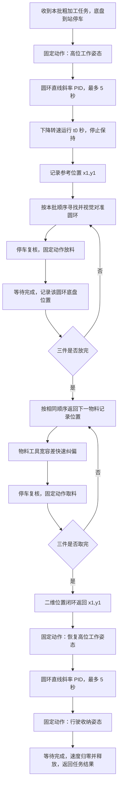

# 粗加工区三放三取任务流程与实施指导

> 2026-11-15 流程更新：本文保留为旧版底盘方案记录。当前粗加工改用高位底盘对准2号环、逐件机构视觉放置、实际长度/角度反馈取回，首尾纠偏最多3秒，无底盘P0返程。以[新版指导计划](14_粗加工区龙门架改造指导计划.md)和[新版使用说明](../../ros2_ws/src/agv_perception/COARSE.md)为准。

> 动作号更新（2026-11-15）：本文原有编号为历史占位，以[通信协议v0.5接入记录](通信协议v0.5接入记录.md)及当前YAML为准。新版所有取放动作完成后返回工作位。

日期：2026-11-09。本文最初为已确认的实施规格；现已按该规格接入业务代码，构建和软件链路已验证，现场标定与电控实车验收待完成。实际配置、启动和接口见[粗加工使用说明](../../ros2_ws/src/agv_perception/COARSE.md)，实施记录见[07_粗加工区实施记录](07_粗加工区实施记录.md)。下文“待实现”描述保留为设计时的能力划分，实际完成状态以实施记录为准。没有更改机械臂协议文档，也没有执行实车动作。

本文以本次用户逐项确认的需求为准。粗加工流程与旧文档冲突时，按本文执行；`docs/弃用` 中的方案、旧动作号和旧归位要求不作为本次实现依据。

## 1. 任务目标与已确认约定

比赛状态机在第一批、第二批各调用一次同一粗加工任务。每次调用完成三个物料全部放置、再按相同顺序全部取回，返回本次参考位置，恢复高位观察姿态进行视觉角度纠偏，最后收纳机械臂并交回调度。

| 项目 | 本次确定的行为 |
|---|---|
| 比赛阶段 | `COARSE_BATCH_1=6`、`COARSE_BATCH_2=12` |
| 区域任务 | `/vision/coarse/run_batch`，`RunWorkBatch`，`operation=COARSE_PROCESS` |
| 放置顺序 | 按本批物料索引顺序及其对应位置数组，不固定为圆环 1→2→3 |
| 取回顺序 | 与放置顺序相同，全部放完后立即开始取回 |
| 加工等待 | 不增加等待时间；从最后放置点返回第一个取回点的行程承担等待 |
| 放置定位 | 圆环工具直接提供编号和原图中心，不重新按左右赋编号 |
| 取回定位 | 返回各放置记录位置后，使用物料工具按目标颜色做快速视觉纠偏 |
| 取回精度 | 使用独立且较大的像素容差，速度优先 |
| 标定点 | 三个圆环及物料取回共用同一个像素标定点，默认实际图像中心 |
| 中心来源 | 使用工具给出的有效最终中心；几何圆心优先，允许框中心 |
| 相机安装 | 固定在机械臂末端，会随机械臂升降和动作运动 |
| 动作后姿态 | 每次放料、取料固定动作完成后，恢复到首次下降后的低位观察姿态，并允许底盘移动 |
| 工作位与收纳位 | 两个不同的固定动作：工作位用于高视角观察，收纳位用于离站行驶 |
| 初始参考位置 | 首次下降结束、停止保持后记录底盘 `(x1,y1)` |
| 放置位置 | 每次放料动作完成并停车后，记录该圆环对应的底盘 `(x,y)` |
| 位置返回 | 使用二维里程计位置闭环，不记录目标 yaw，不做返回朝向 PID |
| 角度纠偏 | 入站高位、离站前恢复高位后各一次，用圆心拟合直线斜率 PID |
| 角度超时 | 每次最多 5 秒；超时停止角速度并跳过，继续正常后续流程 |
| 其他异常 | 报错、停止，不自动重试、跳物料或自动续跑 |

### 1.1 输入例子

本批 `colors=[5,1,6]`、`positions=[2,3,1]` 时：

| 物料索引 | 颜色 | 放置圆环 | 取回目标 |
|---|---|---|---|
| 1 | 黑色，5 | 2 | 回到圆环 2 的放置记录位置，识别黑色物料 |
| 2 | 红色，1 | 3 | 回到圆环 3 的放置记录位置，识别红色物料 |
| 3 | 浅蓝色，6 | 1 | 回到圆环 1 的放置记录位置，识别浅蓝色物料 |

六项业务动作固定为 `PLACE:1、PLACE:2、PLACE:3、PICK:1、PICK:2、PICK:3`。步骤 ID 的数字是物料索引，不是圆环编号。颜色编号沿用现有接口：红 1、黄 2、蓝 3、绿 4、黑 5、浅蓝 6。

## 2. 当前已有能力与本次待实现能力

### 2.1 已有能力

- [圆环识别工具](../../tools/ring_debug/README.md)及 `RingDetector`：提供圆环编号、原图中心、有效性、中心来源、帧序号和时间戳。
- [物料识别工具](../../tools/material_debug/README.md)及 `MaterialDetector`：提供颜色编号、原图中心、中心来源；支持按 `target_color_id` 过滤。
- 比赛调度已有两次粗加工阶段、`RunWorkBatch` 客户端、六项确认记录与区域执行端运行查询/停止/复位约定。
- C 板桥接已有底盘速度发送、`/C/odometry` 二维里程、`/C/status` 状态反馈。
- [机械臂通信协议](../../上位机通信协议（机械臂）.md)已定义 `0x02 ARM_CMD`、`0x03 ARM_JOG`、ACK 与机械臂状态语义。

### 2.2 待实现能力

- 粗加工任务状态机、两种视觉目标之间的切换、PID、位置记录与二维返回。
- 视觉速度经比赛调度统一转发的通路；当前调度器只接收导航速度，区域阶段持续输出零速。
- 桥接节点的机械臂固定动作、速度点动、ACK 对应及动作完成等待；协议已有定义不等于 ROS 桥接已经接入。
- 最终视觉角度超时跳过与现有调度结果检查之间的兼容。
- 单份相机采集与两种模型在比赛任务中的集成。

本文中新增的状态名、参数名、速度输入话题和结果字段属于实施设计，不能当作已经存在的运行接口。

## 3. 完整执行流程



两次角度校准，无论成功还是达到 5 秒上限，都沿图中后续正常路径继续；其他错误进入停止/报错路径。

### 3.1 状态与转移表

| 状态 | 底盘输出 | 机构/视觉行为 | 正常下一步 |
|---|---|---|---|
| `ENTER_WORK_POSE` | 全零 | 发工作位动作一次，等 ACK 及动作完成 | `ALIGN_ENTRY` |
| `ALIGN_ENTRY` | 仅角速度 | 高位圆环直线纠偏；成功或 5 秒超时后归零 | `LOWER_CAMERA` |
| `LOWER_CAMERA` | 全零 | 持续下降点动 `t0` 秒，然后发送停止保持 | `CAPTURE_REFERENCE` |
| `CAPTURE_REFERENCE` | 全零 | 用停止后的新鲜里程记录 `(x1,y1)` | `FIND_RING`，索引 1 |
| `FIND_RING` | 必要时平移，角速度零 | 当前目标可见即转伺服，否则按编号左右关系横向寻找 | `ALIGN_RING` |
| `ALIGN_RING` | 两路平移 PID，角速度零 | 对准指定编号圆环，共用标定点，放料容差 | `VERIFY_PLACE` |
| `VERIFY_PLACE` | 全零 | 停稳后用新图复核；不合格回到对准 | `PLACE` |
| `PLACE` | 全零 | 发放料动作一次，等待完成并恢复低位姿态 | `RECORD_PLACE` |
| `RECORD_PLACE` | 全零 | 记录该圆环底盘位置，提交本项完成记录 | 下一 `FIND_RING`；第三件后 `RETURN_ITEM` |
| `RETURN_ITEM` | 两路位置闭环，角速度零 | 去本索引物料的放置记录位置 | `ALIGN_MATERIAL` |
| `ALIGN_MATERIAL` | 两路平移 PID，角速度零 | 物料工具选择本索引颜色，使用取料宽容差 | `VERIFY_PICK` |
| `VERIFY_PICK` | 全零 | 停稳后用新图复核；不合格回到纠偏 | `PICK` |
| `PICK` | 全零 | 发取料动作一次，等待完成并恢复低位姿态；提交本项完成记录 | 下一 `RETURN_ITEM`；第三件后 `RETURN_REFERENCE` |
| `RETURN_REFERENCE` | 两路位置闭环，角速度零 | 返回本批 `(x1,y1)` | `RESTORE_WORK_POSE` |
| `RESTORE_WORK_POSE` | 全零 | 发工作位动作一次，等待高位姿态完成 | `ALIGN_EXIT` |
| `ALIGN_EXIT` | 仅角速度 | 高位圆环直线纠偏；成功或 5 秒超时后归零 | `STOW_ARM` |
| `STOW_ARM` | 全零 | 发独立收纳动作一次，等待完成 | `COMPLETE` |
| `COMPLETE` | 全零并释放 | 返回完整结果，不再提交新运动 | 本批结束 |
| `ERROR` | 全零 | 报错、停止，保留已确认步骤及未完成动作事实 | 等待外部停止/复位 |

校准、下降、动作等待、视觉和位置闭环均由非阻塞状态推进；不使用阻塞休眠或忙等阻塞 ROS 回调。

## 4. 数据记录与生命周期

本批上下文至少保留：

| 数据 | 用途 |
|---|---|
| `run_id / task_id / task_revision / batch / stage` | 绑定本次比赛与区域调用 |
| `colors[3] / positions[3]` | 固定任务快照，按同一索引关联 |
| `phase / item_index` | 当前放料/取料阶段及物料索引 |
| `reference_xy` | 首次下降停止后的 `(x1,y1)` |
| `placement_xy[position_id]` | 每个圆环本次放置完成后的底盘位置 |
| `odom_session_id / motion_epoch` | 绑定记录与本轮坐标、控制许可 |
| `confirmed_steps` | 按顺序累计的六项动作确认前缀 |
| `arm_pending` | 当前是否存在已发出但尚未确认结束的机构动作 |
| `entry_alignment_outcome / final_alignment_outcome` | 区分视觉纠偏达标与超时跳过 |

所有位置来自 `/C/odometry` 的 `x_m/y_m`，不积分已下发速度，不把像素坐标当作米制位置。每批入站重新记录参考与三个放置位置；第二批不得复用第一批记录。只存 x、y，不把某个 yaw 作为返回目标。

位置记录时底盘保持零速，并取动作/下降结束后的新鲜里程样本。若坐标会话或控制许可改变，现有记录不再用于继续任务，报错停止。

## 5. 视觉与控制算法

### 5.1 坐标、共同标定点及中心来源

统一使用工具的实际原图坐标：左上原点，`u` 向右、`v` 向下，单位 px。图像尺寸从结果读取，默认标定点为 `((W-1)/2,(H-1)/2)`；可在 YAML 填写实际标定值。放置和取回引用同一标定点。

工具输出 `valid=true` 且 `center_px` 存在时才用于控制。直接采用 `center_px`，中心来源仅用于记录和诊断，不在任务层重新做一次找圆、框中心选择或置信度筛选。`BBOX_ONLY` 可用于角度拟合和最终对准，不强制要求几何圆心；无效观测的诊断框中心不能当有效中心使用。

相机在末端：高位只执行入站/离站直线纠偏，低位执行逐目标对准；机构运动期间不使用历史图像纠偏。到达新机构姿态后从新采集帧重新开始计数。

### 5.2 圆心直线斜率 PID

输入为同一张新鲜图像中两个或三个不同编号圆环的有效中心。三个可用就全部使用；只有两个可用时用这两个。编号由工具给出，不要求只用 1、3，也不因遮挡重编编号。

以最小二乘拟合 `v=k*u+b`，斜率可直接计算为：

```text
u_mean = mean(u_i)
v_mean = mean(v_i)
k = sum((u_i-u_mean)*(v_i-v_mean)) / sum((u_i-u_mean)^2)
e_k = 0 - k
wz_rad_s = clamp(PID_slope(e_k), -max_wz_rad_s, +max_wz_rad_s)
vx = 0
vy = 0
```

横向跨度不足以计算斜率或少于两个有效中心时，输出零角速度并继续等新帧，仍计入本次 5 秒总时限。不额外增加平移寻找三个圆环的流程。

在工具坐标中，右侧圆环偏高时 `k<0`，因此 `e_k>0`；正增益 PID 输出正 `wz`，即底盘逆时针旋转，符合用户确认的方向。目标始终是图像直线水平，不使用 `yaw=0°/90°` 等绝对航向目标。

完成判据为 `abs(k) <= slope_tolerance` 连续满足 `settle_frames` 张不同采集帧，然后零速稳定并用新帧复核。复核若不合格且未到时限则继续纠偏。5 秒从进入校准状态开始计时，包含等图、目标不足、纠偏和停车复核，不能每次看到目标或进入复核时重置。

结果分为 `ALIGNED`、`TIMEOUT_SKIPPED`、`NOT_RUN`。前两者均进入后续流程，超时日志须明确未确认角度达标。相机实际断流、推理报错、通信异常等属于异常，不借校准超时将其吞掉。

### 5.3 圆环与物料的平移视觉 PID

设标定点为 `(u_ref,v_ref)`，检测中心为 `(u,v)`：

```text
e_u = u - u_ref
e_v = v - v_ref
distance_px = sqrt(e_u^2 + e_v^2)
vx_mps = clamp(-PID_u(e_u), -max_vx_mps, +max_vx_mps)
vy_mps = clamp(+PID_v(e_v), -max_vy_mps, +max_vy_mps)
wz = 0
```

上述符号来自用户指定的像素与底盘关系：在左下原点、向上为 y 的例子中，检测 `(200,200)`、标定 `(100,100)`，转换为工具坐标后得到 `e_u=+100`、`e_v=-100`，因此最终串口 `vx<0、vy<0`。底盘协议本身仍是 x 前、y 左，不交换串口字段。

“目标在图像右侧”和“车体向右”不是同一个坐标概念。搜索与伺服必须复用同一图像—底盘方向映射，不能搜索按一个坐标系、伺服按另一个坐标系。例如目标在图像右侧时，按上述映射其搜索输出为负 `vx`，不直接硬编码成车体负 `vy`。

放料和取料各有两路 PID、限速、欧氏距离容差及连续帧数，标定点共用。取料容差大于放料容差，优先在记录位置附近尽快完成，不额外强制几何圆心或更长稳定窗口。

PID 的时间增量使用有效新观测间隔；同一采集帧不能重复计算积分、微分或增加合格帧数。切换目标、阶段或失去有效观测时清理该段 PID 历史及连续合格计数；限幅时避免积分继续积累。首轮可令 `ki=kd=0` 从 P 调起，但实现保留用户要求的 PID 三项参数。

### 5.4 放料目标寻找

当前目标圆环已有有效中心时，直接进入精对准。尚不可见、但能看到其他编号时，根据已知编号左右顺序决定搜索方向，用配置的低速沿对应图像横向方向平移；目标有效后立即切为视觉 PID。

不设计自动反向扫描、逐层扩大搜索区域或复杂重定位。预期赛场起步至少可见一个圆环；如果完全没有有效圆环，先零速等候，超过目标缺失时限则报错停止，而不是继续盲移。

### 5.5 取料目标选择与停车复核

返回本索引记录位置后调用物料工具，按 `colors[item_index]` 选择有效候选。优先沿用现有 YOLO 顶面配置及中心反馈；不自动切换模型或后端。若同色存在多个实例，取最接近共同标定点的有效中心，利用已返回对应物料位置的前提选择目标，不另建全场追踪。

距离达标后底盘输出零速，经过配置的短暂停车稳定时间，再用停车之后的新鲜观测复核。复核达标才发取放动作；不达标返回该目标视觉 PID。取料同样复核，但使用宽容差与较短连续帧数，不增加独立长时间确认。

### 5.6 二维位置闭环

目标与当前位置都属于同一固定里程会话坐标系。先在该固定系计算两路位置 PID，再转换为当前车体系发送：

```text
e_x = x_goal - x_now
e_y = y_goal - y_now
Vx_fixed = PID_return_x(e_x)
Vy_fixed = PID_return_y(e_y)
vx_body = cos(yaw_now)*Vx_fixed + sin(yaw_now)*Vy_fixed
vy_body = -sin(yaw_now)*Vx_fixed + cos(yaw_now)*Vy_fixed
wz = 0
```

这里读取当前 yaw 仅用于固定系速度转换到车体系，不保存目标 yaw、不做角度环，符合只用 x、y 闭环返回的要求。不能把固定坐标系的 x、y 误差不经转换直接当车体速度。

输出按配置限速；欧氏位置误差小于 `position_tolerance_m` 后停车，稳定后复核新里程，再进入下一状态。取回物料位置和最终参考位置均复用此能力；返回阶段不同时运行视觉平移环。

## 6. 机械臂通信与动作契约

### 6.1 固定动作映射

全部动作号放在 YAML，不写死到状态机。占位安排如下：

| 参数 | 暂用动作号 | 含义 |
|---|---|---|
| `work_pose_cmd` | 2 | 恢复高位标准工作姿态，入站和离站前复用 |
| `place_cmd` | 3 | 在当前已对准位置放一件，完成后恢复低位姿态 |
| `pick_cmd` | 4 | 在当前已对准位置取一件，完成后恢复低位姿态 |
| `stow_cmd` | 5 | 恢复初始行驶收纳姿态 |

`0=STOP/ABORT`、`1=HOME` 是现有协议保留语义，不能当普通业务动作占位。2～5 是上位机配置草案，不代表电控动作表已经实现。下位机负责夹爪、料仓转位、避让及完整内部时序，上位机不发独立转仓指令、不计算仓盘角度。

### 6.2 固定动作发送和完成

- 使用 `0x02 ARM_CMD`，负载 `cmd:uint8 + reserved[3]=0`；每次进入动作状态发送一次，不随图像回调反复发送。
- 同一时刻只存在一个待确认固定动作。`0x83 ACK` 只带消息 ID 与受理结果，不带动作号/事务号，因此串行执行，不建立并行动作队列。
- ACK 成功只说明受理。随后依据新鲜 `STATUS.arm_state` 从忙态 `1/2` 回到 `0` 确认动作结束；旧 idle 不能作为新动作完成证据。`arm_state=3` 或 ACK 拒绝时报告错误。
- ACK 超时或动作完成超时不自动重发，不以固定睡眠代替完成反馈；报告原因及动作是否仍未确认。没有观察到可信完成依据时，不推进物料索引。
- 固定动作等待期间持续给底盘零速心跳。状态与 ACK 复用同一个 C 板串口桥接接收通路，视觉节点不另开串口。

### 6.3 定时下降

首次角度纠偏结束后，使用 `0x03 ARM_JOG`：

| 字段 | 下降阶段 |
|---|---|
| `yaw_wz` | 0 |
| `fb_rpm` | 0 |
| `ud_rpm` | `-lower_speed_rpm`，配置值填写正的下降转速幅值 |
| `mode` | 1 |
| 周期 | 50 Hz |

从桥接实际开始发送下降指令起，以单调时钟计时 `lower_duration_s=t0`。达到时长后显式发送三轴零速、`mode=0` 停止并保持，清除桥接中锁存的下降速度，之后不再重发旧非零值。定时下降不是位置控制，单位为电机 RPM，不是 m/s。

停止后确认机构退出运动状态，再记录参考 x、y 并开始找圆环。每次取放动作已经恢复低位，不重复执行本段下降。

### 6.4 本次流程与现行协议的一项差异

现行协议写有“JOG 后位置基准无效，固定绝对动作前需 HOME 或重建基准”。用户本次明确要求：**下降后直接寻找并放料，不插入 HOME、不改执行顺序。** 上位机业务按本流程实现，不自行增加回零。

下位机需要支持下降后直接受理上述固定动作；本文不宣称该能力已落地，也不改写现行协议来掩盖差异。联调时若实际返回“位置基准无效/不支持”，按异常报错停止，不能假装成功或自动改成回零流程。

## 7. 比赛调度和输出控制权

### 7.1 单一最终速度出口

保持现有约定：`mission_node` 独占 `/C/controll`，C 板桥接只订阅该最终速度话题。粗加工任务不与调度器同时向它发布。

实施时增加 `/vision/coarse/control` 作为区域速度输入，消息沿用现有 `RouteControl` 的身份、序号、命令与执行状态封装，作为粗加工控制适配；其 `request_id` 对应当前区域 `task_id`。这是拟新增的区域输入通路，不改变现有 `/route/control` 的导航用途。

调度器仅在已受理的粗加工任务为当前活动任务时转发该输入，并校验当前任务、执行进程、坐标会话和控制许可；导航阶段接收导航输入，其余阶段输出零速。不能保留现有“只要不是 route 就持续归零”的分支导致视觉命令被覆盖。

视觉图像可以低于 50 Hz；区域控制循环按配置频率发布有当前有效依据的命令，重复控制发布不重复增加图像合格帧数。图像过期就归零，不能靠反复发送缓存速度延长视觉结果有效期。底盘最终串口保持 50 Hz。ROS `ControlCommand.omega_deg_s` 使用 °/s，而协议 `wz` 使用 rad/s：内部若以 rad/s 算角速度，在发布 ROS 消息时转换一次，桥接再按原有规则转换到串口。

### 7.2 区域运行接口

粗加工执行端沿用 `/vision` 运行查询、停止、复位及 `/vision/coarse/run_batch` Action 约定，不另建一套比赛调度状态机。运行状态使用已有 `ExecutorRuntime`，并与现有任务身份、进程会话及比赛心跳约定衔接。

正常结果具备完整六项 `confirmed_steps`、`all_items_completed=true`、底盘输出停止且已释放、机构空闲、收纳完成并允许行驶。`controller_completed=true` 只表示下位机完整动作结束；视觉对准成功不等于抓取质量已由传感器验证，不能据此把 `visually_verified` 写成抓取成功。

### 7.3 最终角度超时与结果字段

当前 `mission_node` 强制要求 `reference_restored=true`，直接照旧接入会把用户要求的“最终角度超时后继续”判为失败。实施时必须同步修改这一处验收逻辑，不能通过伪造角度已达标绕过。

本方案在 `RunWorkBatch.action` 的 Result 末尾追加 `string final_alignment_outcome`，取值为 `ALIGNED / TIMEOUT_SKIPPED / NOT_RUN`。这只是后续源接口变更计划；本次不修改 Action 文件或生成文件。接口改动后依仓库现有流程重新构建接口及依赖包。

| 最终角度结果 | `reference_restored` | 允许区域成功的条件 |
|---|---|---|
| `ALIGNED` | true | x、y 返回完成，最终角度复核达标，六项动作及收纳完成，速度释放 |
| `TIMEOUT_SKIPPED` | false | x、y 返回完成，高位工作动作完成，最终角度确实达到 5 秒上限，六项动作及收纳完成，速度释放 |
| `NOT_RUN` 或异常 | false | 不允许成功 |

调度器仅对 `COARSE_PROCESS` 接受表中第二行例外，不放宽其他区域的归位条件；不得跳过 x、y 返回、完整取放或收纳。超时跳过时结果 `reason` 明确写出最终角度未验证达标；本批仍可 `outcome=COMPLETED`，因为这是用户指定的正常继续路径。

入站角度结果只记录在任务上下文和日志中，不影响最终归位标志。`travel_ready` 表示机构已处于可行驶状态，不代表角度精度达标。

## 8. 参数设计与 YAML 草案

建议后续新增 `ros2_ws/src/agv_perception/config/coarse.yaml`，由区域节点加载。下列是业务配置草案，不是现有可运行 ROS 参数文件；嵌套项由加载入口转换为内部配置，不直接传给 `--params-file`。`null` 为现场待标定值，未标定的控制参数不能伪装成已验证默认值。

```yaml
coarse:
  arm:
    work_pose_cmd: 2
    place_cmd: 3
    pick_cmd: 4
    stow_cmd: 5
    lower_speed_rpm: null          # 正幅值，实际 ud_rpm 取负
    lower_duration_s: null         # t0
    jog_rate_hz: 50.0
    ack_timeout_s: null
    action_timeout_s: null

  vision:
    ring_config: /root/工创/ros2_ws/src/agv_perception/config/ring.yaml
    material_config: /root/工创/ros2_ws/src/agv_perception/config/material.yaml
    target_uv_px: []               # 空：实际原图中心；否则 [u,v]，取放共用
    max_frame_age_s: 0.5           # 沿用工具当前起点，按实际延迟验收
    target_missing_timeout_s: null

  angle_alignment:
    timeout_s: 5.0                 # 入站、离站各自独立计时
    timeout_policy: skip
    target_slope: 0.0
    min_ring_count: 2
    min_horizontal_span_px: null   # 防止横向跨度过小无法稳定算斜率
    slope_tolerance: null
    settle_frames: 3               # 初始调试建议，可调整
    max_wz_rad_s: null
    pid: {kp: null, ki: 0.0, kd: 0.0}

  place_servo:
    tolerance_px: null
    settle_frames: 3
    max_vx_mps: null
    max_vy_mps: null
    u_pid: {kp: null, ki: 0.0, kd: 0.0}
    v_pid: {kp: null, ki: 0.0, kd: 0.0}

  pick_servo:
    tolerance_px: null             # 必须大于放料容差，速度优先
    settle_frames: 1               # 初始调试建议；仍有停车后新帧复核
    max_vx_mps: null
    max_vy_mps: null
    u_pid: {kp: null, ki: 0.0, kd: 0.0}
    v_pid: {kp: null, ki: 0.0, kd: 0.0}

  ring_search:
    image_horizontal_speed_mps: null  # 按第 5.3 节映射到底盘，非像素速度

  xy_return:
    position_tolerance_m: null
    max_vx_mps: null
    max_vy_mps: null
    x_pid: {kp: null, ki: 0.0, kd: 0.0}
    y_pid: {kp: null, ki: 0.0, kd: 0.0}

  execution:
    control_rate_hz: 50.0
    zero_settle_time_s: null
    visual_step_timeout_s: null    # 含寻找、对准、停车复核，不无限重置
    xy_return_timeout_s: null
```

参数在配置入口一次性校验：动作号与协议范围、必需数值、单位、PID 参数、像素容差、控制频率、共用标定点、取料容差大于放料容差等。任务数组在 Action 入口校验：三个合法且不同的颜色，位置为 1、2、3 的排列。已确定类型的内部数据不逐层重复检查。

动作号占位、`settle_frames` 等是实施草案；模型阈值继续在现有 `ring.yaml/material.yaml` 维护，不复制一份到区域配置，也不擅自调整工具识别算法。

## 9. 相机与识别集成

比赛任务使用单份主相机采集。高位校准、圆环放料对准阶段运行圆环检测；低位取回阶段运行物料检测；动作等待不根据图像输出运动。调用可复用检测核心，不通过浏览器刷新或抓取网页坐标控制车辆。

圆环和物料模型初始化后复用，不按每个物料重复加载模型。两个独立网页/ROS 调试工具不能同时打开同一相机，比赛时由任务采集端统一供图。

当前两套部署运行库都使用 `samples/utils` 包名，物料适配器还会检查既有导入来源。后续集成需先核对两套模型运行库版本，验证后让两种模型使用同一兼容运行库根路径；不能仅轮换 `sys.path` 以为两个库可以同进程共存。若核对后确实不兼容，将模型执行隔离到各自工作进程，仍由单一采集端供图、按任务阶段启用；这是具体集成依赖，不得把当前两个独立工具能运行当作组合任务已经跑通。

保留采集序号与原始读帧时间，结果时效从采集/读帧起算，不能在推理结束后重新盖时间戳把旧图当新图。网页编码、显示和日志不得阻塞控制和采集。

## 10. 异常、停止与结果真实性

只处理任务实际需要的错误：无效配置、识别/相机错误、目标持续缺失、普通步骤超时、里程失效、控制许可失效、固定动作拒绝或结果未知。除两次角度校准达时限允许跳过，其余错误统一进入停止并报错路径。

停止行为：底盘发布零速并撤销当前非零命令；若正在下降则发送 JOG 零速停止保持；存在进行中的固定动作时使用协议已有 `STOP/ABORT` 请求停止。只按协议报告受理、空闲或未确认状态，不额外设计自动回零、恢复动作、硬件断电或重试流程。通信或控制许可已经丢失、无法确认停止时，必须保留“机构停止未确认”的事实，不能仅因软件发出停止请求就返回机构空闲。

暂停/停止入口停止提交后续取放动作。未知或超时的固定动作保留 `arm_pending`/结果未知事实；恢复连接后不自动继续。停止服务的“已受理”与运行状态的“确已静止”按现有接口分别表达。

以下情况不能报告本批成功：只发了指令未等完成、未完成六项动作、没有真实位置返回、工作位/收纳动作失败、底盘控制未释放。最终角度 5 秒超时是第 7.3 节明确列出的唯一归位精度例外。

## 11. 建议实施顺序与改动范围

按可独立验证的顺序推进，不引入仓库未使用的框架或工具：

1. **协议桥接接入**：在 `agv_cboard` 源码增加 ARM_CMD/ARM_JOG 编解码、发送、ACK 与动作完成跟踪，共用现有串口；先验证真实反馈，不运行整批。
2. **识别集成**：确认共用运行库，单相机切换圆环/物料检测，保证来源和帧时效正确；保留现有工具独立调试能力。
3. **基础控制**：实现斜率 PID、两路视觉 PID、二维返回；先调单个圆环与单个物料。数学/控制逻辑复用确有意义时再提取，不先建通用区域框架。
4. **区域状态机**：在 `agv_perception` 中增加粗加工执行模块及配置入口，实现表中正常流程、位置记录、六项完成记录和错误退出。
5. **调度接入**：增加区域速度转发入口；追加最终角度结果字段并重建接口，更新粗加工专属超时跳过验收，保留其他区域原有要求。
6. **逐段联调**：高位—纠偏—下降、一个圆环放置、三放、记录位置取回、最终返回与收纳，最后连通两批比赛阶段。

主要后续涉及 `agv_perception` 区域源码/配置/启动入口、`agv_cboard` 通信源码、`agv_mission` 控制与验收逻辑，以及 `agv_interfaces/action/RunWorkBatch.action` 源文件。生成文件通过现有构建生成，不手工编辑。

## 12. 验证与验收清单

### 12.1 软件验证

| 场景 | 必须看到的行为 |
|---|---|
| 本批目标位置为 2、3、1 | 放料顺序 2→3→1，取回也按同一物料顺序，不按圆环编号排序 |
| 三环/两环、右侧较高 | 斜率计算使用有效新帧，负斜率输出正底盘角速度 |
| 不足两环直到 5 秒 | 期间零角速度等候，到时记录跳过并进入下一步，不无限延长 |
| 校准连续达标与停车复核 | 不重复累计同帧，不用停车前旧图冒充停车后达标 |
| 用户给定像素误差例子 | 按工具坐标转换后，最终底盘 vx、vy 同为负 |
| 几何失败退回框中心 | 工具标有效时允许最终对准，不重新强制几何成功 |
| 下降时间完成 | 显式 JOG 停止，不残留周期性非零下降速度；随后才记录参考 |
| 放料动作 ACK 成功但仍忙 | 不记录该项完成，不提前移动到下一圆环 |
| 三次放料后的记录 | 记录底盘米制 x、y，并按圆环/物料索引正确关联 |
| 返回时当前 yaw 非零 | 固定系误差正确转换车体速度，wz 始终为零，无目标 yaw 控制 |
| 物料初始已在宽容差内 | 停车新帧复核后直接取，不强制先产生纠偏运动 |
| 最终视觉超时 | 收纳后可结束粗加工；结果明确为 TIMEOUT_SKIPPED，不伪报角度达标 |
| 已有调度器的区域速度分支 | 粗加工时转发区域速度，不被导航专用归零逻辑覆盖 |
| ACK 拒绝、机构故障、普通步骤超时 | 报错停止，不自动重发固定动作或跳物料 |
| 第二批调用 | 同一执行逻辑使用第二批数组，重新记录全部位置，不继承第一批控制历史 |

测试应调用真实控制/状态实现；协议用字节流和仓库现有 PTY 流程验证，不复制业务逻辑到测试里，不为简单参数读写堆叠测试。

### 12.2 实车调试顺序

1. 核对下位机 2～5 动作号，确认取放结束恢复同一低位观察姿态、收纳为独立姿态，确认定时下降后能够直接执行固定动作。
2. 在高位确认两个/三个圆环同时可见，低速验证斜率方向与正角速度，调整角度 PID、斜率容差；单次保持 5 秒上限。
3. 标定下降 RPM 与 `t0`，确认低位图像可用于取放，标定共用准心；低速分别验证图像 u、v 误差对应的串口速度符号。
4. 调整放料 PID 和欧氏容差，再按实际夹爪容许偏差放宽取料容差，记录耗时和成功情况，不预先宣称某个像素容差已适用。
5. 验证每次放置后的 x、y 记录、取回位置闭环与物料快速纠偏；检查非零当前航向时返回坐标转换。
6. 验证最终先回 `(x1,y1)`、再恢复高位、再角度纠偏、最后收纳的严格顺序，以及最终角度超时跳过路径。
7. 运行两批不同位置排列，确认全放后全取、无额外等待、六项记录完整且下一路线只在收纳及控制释放后开始。

### 12.3 每次调试保留的记录

记录批次/任务身份、状态转移、目标颜色和圆环、帧序号与年龄、中心来源、像素误差/斜率、底盘控制量、参考与放置位置、动作号、ACK、机构状态、校准结果及异常原因。优先保留已有日志结构，不另建复杂日志系统。

本文档验收只代表需求与接口设计一致。模型已有单独验证不代表完整粗加工任务、下降后固定动作、两批比赛及实车取放已经验收。

## 13. 实施前阅读入口

- [圆环工具说明](../../tools/ring_debug/README.md)、[圆环检测核心](../../ros2_ws/src/agv_perception/agv_perception/ring_detector.py)、[圆环配置](../../ros2_ws/src/agv_perception/config/ring.yaml)。
- [物料工具说明](../../tools/material_debug/README.md)、[物料检测核心](../../ros2_ws/src/agv_perception/agv_perception/material_detector.py)、[物料配置](../../ros2_ws/src/agv_perception/config/material.yaml)。
- [比赛阶段和步骤定义](../../ros2_ws/src/agv_mission/agv_mission/stages.py)、[调度节点](../../ros2_ws/src/agv_mission/agv_mission/mission_node.py)、[区域 Action 源定义](../../ros2_ws/src/agv_interfaces/action/RunWorkBatch.action)。
- [机械臂协议](../../上位机通信协议（机械臂）.md)、[桥接节点](../../ros2_ws/src/agv_cboard/agv_cboard/cboard_bridge_node.py)、[里程反馈消息](../../ros2_ws/src/agv_interfaces/msg/OdometryFeedback.msg)、[车体坐标统一记录](../车体坐标统一实施记录.md)。
