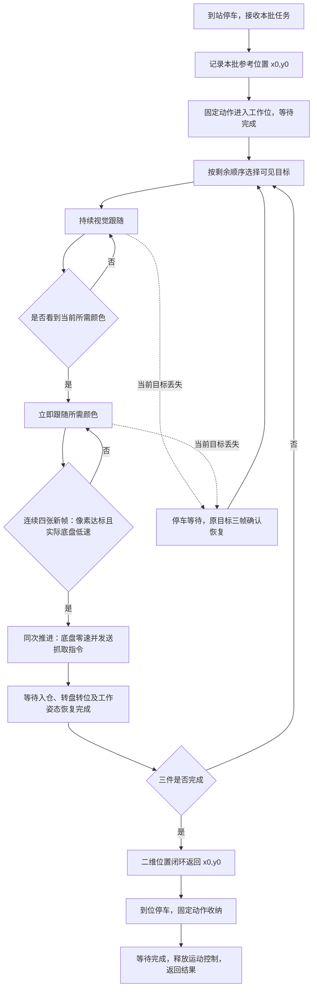

# 原料区两批按序取料任务流程与实施指导

> 动作号更新（2026-11-15）：本文原有编号为历史占位，以[通信协议v0.5接入记录](通信协议v0.5接入记录.md)及当前YAML为准。新版所有取放动作完成后返回工作位。

> 版本提示（2026-11-15）：本文描述旧版底盘逐件跟随流程。新版需求以[原料区龙门架视觉伺服改造指导计划](12_原料区龙门架视觉伺服改造指导计划.md)为准：定位转盘中心后改用伸缩/旋转跟随、缺目标持续等待、先收纳后返程。新版已实施，见[新版实施记录](13_原料区龙门架实施记录.md)；本文只保留为历史需求。

日期：2026-11-09 定稿，2026-11-10 实施。原料控制核心、统一区域执行端及调度速度入口已按本文接入，实际配置与启动见[原料使用说明](../../ros2_ws/src/agv_perception/RAW.md)。下文计划措辞保留为实施规格；现场标定、电控动作表与实车抓取仍待验收。未执行实车动作。

本文以本次用户确认的流程为准。与早期总体方案、`docs/弃用` 中原料方案冲突时，按本文执行。粗加工流程独立遵循[粗加工区指导文件](06_粗加工区任务流程与实施指导.md)，不能把其定时下降、圆环角度纠偏或动作号直接套用到原料区。

## 1. 赛题依据与任务边界

[赛题 PDF](../../1778571778700.pdf)印刷页码第 4 页规定：原料区为直径 300 mm、高 80～100 mm 的电动转盘；一次均匀放置三个物料，物料中线夹角 120°；转向随机，匀速转动速度 6～10 秒/圈，每转停留次数和时间以现场为准，停止位置存在误差。

因此任务要适应运动与停留，不能依靠固定周期、固定方向或固定等待时长推算抓取时机。第 7～8 页要求按任务码顺序逐件抓取，上一件放到机器人上之后才能抓下一件；两批原料分别完成同一流程。

本次确定的处理方法是：底盘持续视觉跟随；当前必须抓取的物料连续四张新帧同时满足对准误差和实际底盘低速条件后，立即发抓取指令并将底盘输出置零，动作执行期间停止底盘运动。该条件是本任务采用的抓取触发判据，不等同于传感器直接证明转盘停止，现场需验证阈值与实际停留窗口相匹配。

## 2. 已确认约定

| 项目 | 确定行为 |
|---|---|
| 调用阶段 | `RAW_BATCH_1=4`、`RAW_BATCH_2=10`，同一实现处理两批 |
| 输入 | `RunWorkBatch`，`operation=RAW_PICK`，三个不同颜色按抓取顺序排列，`positions` 为空 |
| 顺序 | 严格按任务码，不因临时跟随其他颜色而提前抓取 |
| 参考位置 | 到站停车后、发送工作位动作前，记录本批新鲜里程 `(x0,y0)` |
| 工作位 | 发固定动作，等待完成后直接识别和跟随；不下降 |
| 角度控制 | 搜索、跟随与返回均 `wz=0`，首尾不增加角度纠偏 |
| 相机 | 固定在机械臂末端；机构动作期间不使用其图像做底盘伺服 |
| 中心来源 | 不限制识别模式，直接采用物料工具的有效最终 `center_px` |
| 颜色实例 | 赛场同色一次只有一个物料，不增加同色多实例追踪策略 |
| 默认准心 | 当前实际原图中心，可独立标定原料区准心 |
| 临时跟随 | 所需颜色不可见时按剩余顺序选择可见颜色；一旦选中就保持 |
| 正常目标切换 | 看到当前所需颜色就立即追踪，不做三帧确认 |
| 丢失处理 | 停车短暂等待；丢失的原跟随目标重新出现，要三张连续新帧确认后恢复 |
| 抓取触发 | 所需颜色连续四张新帧同时满足像素容差和实际底盘低速阈值 |
| 抓取期间 | 指令发出即禁止底盘运动，涵盖请求、ACK 等待与动作执行 |
| 抓取动作 | 同一动作号，完成抓取、入固定托盘、托盘转 120°、恢复识别工作姿态 |
| 完成依据 | 本次机械臂程序结束即认为本件完成，不额外检测是否抓实 |
| 返回与收纳 | 三件完成后保持工作姿态返回 `(x0,y0)`，到位停车再发收纳动作并等待完成 |
| 异常 | 报错并停止，不自动重试、不跳物料、不自动续跑 |

两批分别记录参考与执行进度；不能沿用上一批位置、目标锁定、连续计数或 PID 历史。原料抓取动作号独立于粗加工地面取回动作号，下位机负责机构高度和内部时序，上位机不发送颜色或仓盘角度。

## 3. 整体流程与状态



图中的丢失恢复为简图，是否恢复原目标或重新选择，严格按第 4 节执行。没有可见目标时原地等候，不按转盘方向盲目扫描，不增加盘体居中、每件返回观察位或运动预测。

| 状态 | 底盘行为 | 任务行为与正常转移 |
|---|---|---|
| `CAPTURE_REFERENCE` | 零速 | 记录停车后的有效新鲜里程，转 `ENTER_WORK_POSE` |
| `ENTER_WORK_POSE` | 零速 | 发工作位动作一次，确认本次完成后转 `FIND_TARGET` |
| `FIND_TARGET` | 零速 | 所需颜色可见则直接锁定；否则按剩余顺序选择临时目标；均不可见就等待 |
| `TRACK_TEMPORARY` | 平移 PID | 保持临时颜色；所需颜色可见立即转 `TRACK_REQUIRED`；当前临时颜色丢失转 `WAIT_REACQUIRE` |
| `TRACK_REQUIRED` | 平移 PID | 只针对所需颜色累计四帧抓取条件；满足转 `PICK`，目标丢失转 `WAIT_REACQUIRE` |
| `WAIT_REACQUIRE` | 零速 | 在有限等待期内确认原目标连续三帧；恢复原跟随状态；到期未恢复则清锁定、转 `FIND_TARGET` |
| `PICK` | 零速 | 进入即发抓取动作一次，等待本次动作完成，确认当前件后推进索引；未满三件转 `FIND_TARGET`，否则转 `RETURN_REFERENCE` |
| `RETURN_REFERENCE` | 二维位置 PID | 返回本批参考位置并停车复核，转 `STOW_ARM` |
| `STOW_ARM` | 零速 | 发收纳动作一次，确认本次完成后转 `COMPLETE` |
| `COMPLETE` | 零速并释放 | 返回完整结果，交回比赛调度 |
| `ERROR / STOPPED` | 零速 | 停止视觉运动并通过已有桥接中止未完成机构动作，保留已确认进度和未确认事实 |

任务推进采用现有周期回调和异步请求，不用阻塞等待占住 ROS 回调。`PICK` 等机构状态不依赖图像是否稳定，不允许视觉回调覆盖零速输出。

## 4. 颜色选择、保持与丢失恢复

### 4.1 必抓目标与跟随目标分开

每批至少保存：

- `item_index`：当前必须抓取的物料索引，1～3。
- `required_color = colors[item_index-1]`：当前必须抓取的颜色。
- `tracked_color`：当前底盘实际跟随的颜色，可能为临时颜色。
- `remaining_colors`：从当前索引开始尚未抓取的颜色列表。

只有 `tracked_color == required_color` 时才能累计抓取合格帧并触发抓取。临时目标无论多么稳定、接近准心，都不能触发机械臂动作。

例如任务顺序为红→蓝→绿，初始只有绿色可见：先跟随绿色；随后蓝色出现仍跟随绿色；红色一出现就立即切到红色。红色动作完成后，再把蓝色设为必抓目标，重新选择当前可见目标。

选择目标时只考虑剩余颜色，抓过的颜色不再参与选择。物料由下位机入仓，上位机不维持已抓物料的视觉轨迹。

### 4.2 正常选择与切换

1. 没有锁定目标时，优先选择所需颜色；不可见时按剩余任务顺序选第一个可见颜色。
2. 临时目标已锁定且持续可见时保持，不因更靠前的其他临时颜色出现而切换。
3. 所需颜色只要提供一张有效新观测，就立即切换到它。初次寻找也不要求三帧确认。
4. 目标切换时重置两路 PID、抓取计数与丢失恢复计数，不累计前一颜色的数据。

### 4.3 短暂丢失与三帧恢复

当前跟随颜色没有有效中心时立即输出零速，清空抓取计数和 PID 历史，进入 `WAIT_REACQUIRE`。不使用丢失前的最后一条非零速度继续追踪。

- 等待时长由 `lost_wait_s` 配置，从丢失开始计时，不因间歇出现而无限延期。
- 丢失的原跟随目标连续三张不同的新帧有效，才恢复跟随；中间再次缺失，恢复计数归零。
- 原目标恢复的第三帧仅用于恢复状态，四帧抓取计数从恢复后的下一张新观测开始，不叠加新等待时长。
- 若丢失的是临时目标，而此时真正所需颜色出现，立即切换跟随所需颜色；它属于正常发现必抓目标，不要求三帧。
- 若丢失的就是所需颜色，则适用原目标恢复三帧规则，不能用“看到了所需颜色立即切换”绕过恢复确认。
- 等待到期仍未恢复，清除原锁定并返回正常选择；之后按第 4.2 节处理，不永久保留丢失标记。
- 无目标时保持零速等待；当前件超过 `item_timeout_s` 仍未进入抓取，则报错停止。

每件的寻找与跟随总时限覆盖临时跟随、所需跟随及丢失等待，不能因切换颜色或恢复目标反复重置。相机断流、过期或推理报错是视觉故障，不能混同于“正常图像里没有目标”。

## 5. 视觉伺服与抓取判据

### 5.1 工具结果与原图坐标

复用[物料工具](../../tools/material_debug/README.md)及 `MaterialDetector`，保持配置选定的 HSV、YOLO 顶面或整体模式。区域任务只消费 `valid=true` 且有 `center_px` 的观测，不在业务层重新选择圆心、框中心或重做颜色识别。

原料阶段必须能同时观察全部剩余颜色，调用核心时使用 `target_color_id=0` 取得全部颜色，再由任务选择目标。不能只把所需颜色传入过滤器，否则无法临时跟随，也不能在跟随临时颜色时发现真正所需颜色。工具已有 ROI 可继续按现场配置使用，但应覆盖预期可观察范围。

坐标沿用原图左上原点，`u` 向右、`v` 向下；单位 px，网页显示缩放不改变结果。原料区准心独立配置，空列表表示实际原图中心 `((W-1)/2,(H-1)/2)`。切换工具模式或工作姿态后重新核对准心，不能假定顶面和整体中心对应同一实物抓取点。

### 5.2 两路平移 PID

```text
e_u = u - u_ref
e_v = v - v_ref
distance_px = hypot(e_u, e_v)
vx_mps = clamp(-PID_u(e_u), -max_vx_mps, +max_vx_mps)
vy_mps = clamp(+PID_v(e_v), -max_vy_mps, +max_vy_mps)
wz = 0
```

符号沿用已确认的像素—底盘关系：在用户举的左下原点示例中，物料 `(200,200)` 对标定 `(100,100)` 应输出负 `vx`、负 `vy`；换成工具坐标后 `e_u>0、e_v<0`，上式符合要求。协议仍然是车体 x 向前、y 向左，不交换串口字段。

临时跟随和所需跟随使用同一套伺服。PID 仅在不同采集序号的新观测到来时更新，以采集时间差计算积分和微分；同一帧不重复更新或计数。两帧之间可在既有图像有效期内保持最新控制值，进入丢失、机构动作、停止或过期状态立即归零。限幅时防止积分继续累积，首轮可将 `ki=kd=0` 从 P 开始标定。

### 5.3 实际底盘低速与四帧触发

实际速度取现有 `/C/odometry` 的 `OdometryFeedback.vx_mps/vy_mps`：

```text
actual_speed_mps = hypot(odom.vx_mps, odom.vy_mps)
qualified = (tracked_color == required_color)
            and (distance_px <= tolerance_px)
            and (actual_speed_mps <= speed_threshold_mps)
```

每张新识别帧配合有效、新鲜且与当前任务坐标会话一致的里程反馈，最多增加一次计数。不能用控制循环执行四次、同一张图读取四次、PID 输出接近零或目标图像位移接近零替代四张新帧。

- 合格则计数加一；任一条件不满足则清零。
- 目标丢失、切换、动作开始和下一件开始均清零。
- 临时目标不得增加该计数。
- 达到四帧时立即进入 `PICK`；同一次状态推进先把底盘输出置零，并提交一次抓取请求，不增加停车稳定延时或第二轮视觉复核。
- 从请求发出即认为 `arm_pending=true`，不等 STATUS 变忙才禁止底盘运动。

四张帧对应的实际时间取决于识别输出率，不能写死为 `4/30` 秒。低速阈值与像素容差共同构成触发条件；跟随过程中仅图像稳定不代表转盘停止，PID 饱和或实际底盘高速时也不能抓取。现场需测量从第四帧到夹爪接触的延迟，确认能在现场停留窗口内执行；不自动增加预测模型或改变用户确认的触发策略。

## 6. 参考位置与二维返回

`CAPTURE_REFERENCE` 在到站停车后、工作位指令前，从 `/C/odometry` 记录 `(x0,y0)`。记录绑定本轮 `odom_session_id/motion_epoch`，不积分已发速度，不使用图像像素代替米制位置。

前三件完成前不逐件回参考位置；抓取结束从当前位置开始寻找下一件。第三件动作结束且恢复工作姿态后，直接二维闭环返回：

```text
e_x = x0 - x_now
e_y = y0 - y_now
Vx_fixed = PID_return_x(e_x)
Vy_fixed = PID_return_y(e_y)
vx_body = cos(yaw_now)*Vx_fixed + sin(yaw_now)*Vy_fixed
vy_body = -sin(yaw_now)*Vx_fixed + cos(yaw_now)*Vy_fixed
wz = 0
```

返回速度按配置限幅，固定系位置误差小于容差后归零，经过配置的短暂稳定时间，用新鲜里程复核，合格才发收纳指令。当前 yaw 仅用于固定系转车体系，不存目标 yaw、不加角度 PID。`reference_restored` 只表示本次二维参考已恢复，不表示朝向纠偏完成。

## 7. 机械臂通信与完成契约

复用[机械臂协议](../../上位机通信协议（机械臂）.md)、现有 `/C/arm_command` 服务和 `/C/arm_execution` 状态，不另开串口。原料流程无 `ARM_JOG`，无需下降点动接口。

| 动作 | 配置项 | 责任 |
|---|---|---|
| 原料工作位 | `work_pose_cmd` | 到达原料识别与抓取姿态 |
| 原料取一件 | `pick_cmd` | 抓取、入当前固定托盘、转位 120°、恢复同一识别工作姿态 |
| 行驶收纳 | `stow_cmd` | 三件取完并回参考位置后恢复离站姿态 |

实施占位采用 `8、9、5` 分别表示以上三个动作，以避开粗加工当前 `2、3、4` 及暂存码垛 `6、7` 的占位；收纳 `5` 可共用。它们只用于规划，不代表电控已经实现。`0=STOP/ABORT`、`1=HOME` 为协议保留动作，不能当业务动作号。实际映射在实施前与电控动作表核对。

每次固定动作通过 `0x02 ARM_CMD` 只发一次。三次取料发相同动作号，下位机自行管理托盘转位，不新增上位机仓盘计数、转位命令或颜色参数。完整动作结束必须同时意味着入仓、转位与恢复工作姿态均已完成。

`0x83 ACK` 仅表示受理，动作结束由本次对应执行状态确认：桥接收到有效 ACK，并依据新鲜 `STATUS.arm_state` 从忙态回空闲形成对应 `command_id` 的完成状态。ROS 本地 `command_id` 用于关联请求，串口原协议不新增事务字段；同一时刻只允许一个待确认固定动作，不能把请求前旧 idle 当作新动作完成。

只有对应动作完成才能提交本件 `PICK:i`，不能在对准、请求已发送、服务已受理或 ACK 成功时提交。按用户约定，程序完成即认为物料完成，不附加视觉复检或夹爪传感器检测；记录 `controller_completed=true`、`visually_verified=false`，避免声称有抓实检测。

动作拒绝、故障或超时均停止并报错，结果未知不重发取料指令，以免托盘再次转位。停止走已有桥接中止流程；只有实际确认机构空闲才能报告 `arm_idle=true`。持续零速底盘心跳沿用已有通信周期。

## 8. 现有能力、实施文件与调度接入

### 8.1 现有能力

| 已有内容 | 当前状态 |
|---|---|
| `agv_mission/stages.py` | 阶段 4、10 和 `RAW_PICK` 已定义，每批三个 `PICK` 步骤，位置为 0 |
| `agv_interfaces/RunWorkBatch` | 已有任务身份、颜色顺序、累计步骤、参考恢复及离站结果字段 |
| `MaterialDetector` | 提供全部颜色、有效中心、帧序号和图像信息 |
| `/C/odometry` | 已提供本轮固定系位置、当前 yaw 和车体系实际速度 |
| C 板机械臂桥接 | 已有固定动作请求、ACK/执行状态与停止能力 |
| 粗加工执行端 | 已有异步机构动作、PID、二维返回和比赛速度转发的参考实现 |

### 8.2 已实现接入与约束

现有 `agv_perception` 包已增加原料核心 `raw_control.py`、配置 `config/raw.yaml`，并接入 `/vision/raw/run_batch`。正式启动和标定见[原料使用说明](../../ros2_ws/src/agv_perception/RAW.md)；机械臂不动作的底盘验证使用[三区域网页工具](../../tools/coarse_debug/README.md)。

原料核心复用可复用的 PID 和二维坐标转换概念，不复制完整粗加工状态机；若需要把公共控制组件提取到共享模块，应保持粗加工既有行为并做对应回归。入口校验任务、配置和外部反馈，内部使用已验证的数据，避免多层重复防御。

已完成以下接入，后续修改应保持这些约束：

1. **统一视觉运行入口。** `CoarseNode` 持有 `/vision/get_runtime`、`/vision/stop`、`/vision/reset_context`，调度器把所有区域视为同一个 `work` 执行端。该共同宿主已接入原料、粗加工、暂存三个 Action 服务，统一运行会话、停止、复位和区域互斥；不要再启动一个原料节点提供重复的 `/vision` 服务。
2. **共享相机。** 同一时刻一个采集者，原料期间只运行物料识别并输出全部颜色；圆环与原料识别不并行争抢设备。机械臂动作期间暂停用于控制的推理，动作完成后重新接收动作结束后采集的新帧。可以复用既有相机生命周期，不要求预加载无关模型。
3. **原料速度转发。** `/vision/raw/control` 类型沿用 `RouteControl`，mission 仅在 4、10 阶段接收；粗加工和暂存分别使用自己的速度入口，并按当前区域匹配来源。
4. **保持唯一速度出口。** 所有区域速度经 mission 仲裁后下发 `/C/controll`；区域节点不直接发布最终速度。导航、原料和粗加工切换时清除旧缓存，待命、机构执行和终态持续零速。
5. **运行身份与停止。** 沿用现有 `ExecutorContract`、租约、`run_id/task_id`、执行进程会话及坐标许可绑定；原料停止取消必须清计数、零速并中止机构，不能因迟到完成反馈恢复运动。

### 8.3 输入、进度与结果

入站校验本批阶段为 4/10、批次为 1/2、`operation=RAW_PICK`、三种合法不同颜色、`positions=[]`、任务及运动许可匹配。颜色业务编号沿用红 1、黄 2、蓝 3、绿 4、黑 5、浅蓝 6。

反馈中的 `item_index/color` 始终表示当前必须抓取的物料，不能用临时跟随颜色覆盖业务目标；临时跟随颜色另记诊断。每件完成后按顺序累积 `PICK:1、PICK:2、PICK:3`，`position=0`，不新增第一层暂存记录。

成功结果必须同时满足：

- `outcome=COMPLETED`，且三个抓取步骤均有对应机构完成确认。
- `all_items_completed=true`。
- `reference_restored=true`，二维返回并停车复核已完成。
- `arm_idle=true`，收纳动作已完成。
- `travel_ready=true`，允许离站。
- `motion_released=true`，终态控制已归零并释放。
- `final_alignment_outcome=NOT_RUN`，原料流程不做角度纠偏。

失败、取消或未知结果不得填完整成功，不因已抓三件就跳过返程、收纳或提前推进下一比赛阶段。原料不套用粗加工角度超时跳过的结果例外。

## 9. YAML 配置草案

下面是待新增的业务配置示例，不是当前可加载文件，也不是 ROS `--params-file` 结构。动作号为占位；`null` 为需要实车标定的值，不虚构可直接运行的 PID、速度与容差。正式运动前按现有配置习惯检查必填项。

```yaml
raw:
  arm:
    work_pose_cmd: 8
    pick_cmd: 9
    stow_cmd: 5
  vision:
    material_config: /root/工创/ros2_ws/src/agv_perception/config/material.yaml
    target_uv_px: []                 # 空值使用实际原图中心
    max_frame_age_s: 0.5             # 初值，按识别延迟核对
    camera_start_timeout_s: 10.0
  tracking:
    lost_wait_s: null                # 短暂丢失后零速等待的总时长
    reacquire_frames: 3              # 仅原跟随目标丢失后的恢复
    item_timeout_s: null             # 每件寻找/跟随总时限，不被切换重置
  servo:
    tolerance_px: null
    max_vx_mps: null
    max_vy_mps: null
    u_pid: {kp: null, ki: 0.0, kd: 0.0}
    v_pid: {kp: null, ki: 0.0, kd: 0.0}
  grasp_gate:
    qualified_frames: 4
    speed_threshold_mps: null        # 实际平移速度 hypot(vx,vy)
  xy_return:
    position_tolerance_m: null
    max_vx_mps: null
    max_vy_mps: null
    x_pid: {kp: null, ki: 0.0, kd: 0.0}
    y_pid: {kp: null, ki: 0.0, kd: 0.0}
    timeout_s: 15.0
    zero_settle_time_s: 0.1          # 只用于返程停车复核，不插入抓取触发
  execution:
    control_rate_hz: 50.0
    feedback_timeout_s: 0.2
    arm_request_timeout_s: 5.0
    lease_timeout_s: 1.0
```

桥接层已有 `cboard.yaml` 的 `arm_ack_timeout_s`、`arm_action_timeout_s`，复用已有超时，不在业务配置里另造同义参数。正常切换不设三帧参数；不新增下降、圆环斜率或目标 yaw 参数。`reacquire_frames=3`、`qualified_frames=4` 是本次确认值，调整意味着改变任务行为。

## 10. 实施顺序

1. 实现纯控制核心与明确状态输入，输入包含有效新帧、全部颜色中心、当前位姿和实际速度、对应机构执行状态；核心不直接打开相机或串口。
2. 接入目标选择、临时保持、立即切到所需颜色、丢失后三帧恢复及四帧抓取门槛，先用观测序列验证真实核心。
3. 复用机械臂桥接实现工作位、三次同号抓取和收纳；提交动作时原子地进入底盘零速状态，完成反馈后推进索引。
4. 接入本批参考记录和二维返回，保持 `wz=0`，不改变粗加工控制行为。
5. 在统一视觉宿主中接入原料 Action、相机模式和运行/停止/复位；补齐 mission 原料速度转发与阶段来源匹配。
6. 使用真实 ROS 节点和伪串口验证两批、取消、拒绝与超时，不以软件验证代替实车标定。
7. 电控动作表核对、低速空载跟随标定、实际转盘窗口及完整两批验收，完成后再记录实际配置和验证结论。

不因本计划自动新增网页调试工具；若后续需要，另按用户指定的调试范围实施。

## 11. 验收清单

| 场景 | 必须观察到的行为 |
|---|---|
| 红→蓝→绿，仅绿可见 | 跟随绿，不能发抓取 |
| 跟绿时蓝出现 | 继续跟绿 |
| 跟绿时红出现一次有效新观测 | 当帧切到红，不等三帧；重置 PID 与抓取计数 |
| 初次即看到红 | 直接跟随，无三帧等待 |
| 临时目标满足全部低速/对准条件 | 始终不能抓取 |
| 目标丢失 | 当次输出归零，不继续旧速度，四帧计数清零 |
| 丢失原目标只恢复一帧/两帧 | 保持零速；三张连续新帧后恢复；间歇缺失重新计数 |
| 临时目标丢失，必抓目标出现 | 立即跟随必抓目标，不把丢失恢复门槛施加给新目标 |
| 丢失等待结束 | 正常重选剩余目标；完全无目标继续零速，当前件总超时停止 |
| 目标切换或丢失恢复 | 不重置当前件总寻找时限 |
| 像素稳定但实际底盘仍高速 | 抓取计数不合格 |
| 实际底盘低速但像素未达标 | 抓取计数不合格 |
| 同一帧重复回调四次 | 最多只计一帧，不能触发抓取 |
| 连续四张新帧同时合格 | 当次零速并发抓取一次，无追加停车复核延时 |
| 第三帧合格，第四帧不合格 | 清零，重新累计四张合格帧 |
| 抓取指令已发但 STATUS 仍为旧 idle | 底盘保持零速，不提前确认完成 |
| 抓取动作期间图像大幅移动 | 不输出跟随速度 |
| ACK 成功但动作未完成 | 不推进当前索引，不重复发指令 |
| 一件程序完成 | 提交本件一次，开始下一剩余颜色；三个取料指令动作号相同 |
| 三件完成 | 先回本批参考，再收纳，完成后交回调度 |
| 第二批开始 | 重新记录参考并清空第一批计数、锁定和控制历史 |
| 模式切换测试 | 使用所选工具有效中心，不强制顶面、不在任务层重做几何定位 |
| 两批 ROS/伪串口集成 | 阶段 4、10 完整执行，6、12 粗加工行为回归通过，串口仅由桥接持有 |
| 原料/导航/粗加工切换 | 仅当前区域速度可转发，旧缓存不能继续运动 |
| 停止、动作拒绝、视觉/反馈异常、超时 | 零速、机构中止、如实报错，不重发抓取或返回假成功 |

现场还需验证：原料工作位与抓取后的观察姿态一致；相机不受仓内已抓物料干扰；托盘完整转位包含在动作完成之前；视觉伺服符号、准心、速度限幅正确；四帧触发到夹爪接触的时间适配现场停留；底盘区域内运动范围适配赛道；返程保持工作姿态可行、收纳后才离站。上述检查用于完成既定流程的实车验收，不自动扩展为盘体识别、路径重规划或运动预测功能。

## 12. 计划完成后的交付

后续实施交付应包括原料执行核心与区域接入、正式 YAML、共享运行入口与相机管理、调度速度仲裁、针对本表行为的核心与 ROS/串口验证，以及实际启动和标定说明。当前实施状态和验证范围见[原料实施记录](11_原料区实施记录.md)；动作号、控制参数及电控实车联调结果仍待现场落实。
