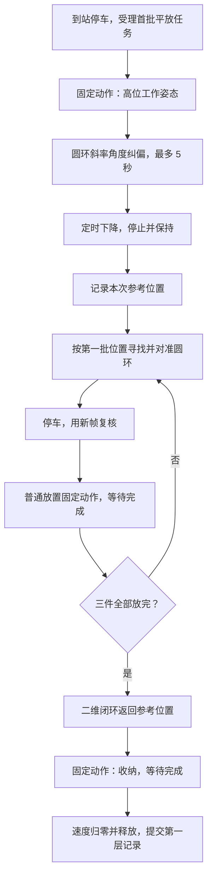
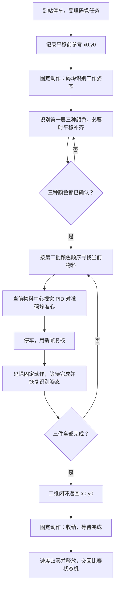

# 暂存区首批平放与第二批码垛任务流程及实施指导

> 动作号更新（2026-11-15）：本文原有编号为历史占位，以[通信协议v0.5接入记录](通信协议v0.5接入记录.md)及当前YAML为准。新版所有取放动作完成后返回工作位。

> 版本提示（2026-11-15）：本页保留旧版底盘对准及回P0约定。现行实现见[龙门架指导计划](14_暂存区龙门架视觉伺服改造指导计划.md)、[新版实施记录](16_暂存区龙门架实施记录.md)和[运行说明](../../ros2_ws/src/agv_perception/STORAGE.md)。新版采用机构逐件高位对准后下降、两次无回P0；本页旧测试仅证明旧行为。

日期：2026-11-09。2026-11-10 已按本计划接入暂存区业务及公共执行端，实际启动、配置和标定见[暂存使用说明](../../ros2_ws/src/agv_perception/STORAGE.md)。本文保留实施前的能力划分和配置规划措辞，具体已完成项与验证范围见[实施记录](10_暂存区实施记录.md)。未执行实车动作，现场参数与电控验收待完成。

本文以本次用户确认的流程为准。粗加工可复用部分以[粗加工指导方案](06_粗加工区任务流程与实施指导.md)及[实施记录](07_粗加工区实施记录.md)为依据；`docs/弃用` 下的旧方案、旧动作号和强制离站角度校准要求不作为实施依据。

## 1. 目标与确认范围

比赛状态机调用暂存任务两次：阶段 8 完成第一层三件平放，阶段 14 按第二批颜色顺序在第一层同色物料上码垛。两次都在实际返回本次参考位置、完成收纳并交回控制权后结束。

| 项目 | 第一次：首批平放 | 第二次：同色码垛 |
|---|---|---|
| 比赛阶段 | `STORAGE_PLACE_1=8` | `STORAGE_STACK_2=14` |
| 操作 | `STORAGE_PLACE` | `STORAGE_STACK` |
| 物料顺序 | 第一批颜色顺序 | 第二批颜色顺序 |
| 实际落点 | 第一批位置数组指定的圆环 | 当前识别到的第一层同色物料 |
| 入站角度纠偏 | 高位圆环斜率 PID，最多 5 秒，超时继续 | 不执行 |
| 定时下降 | 入站纠偏后执行一次 | 不执行 |
| 参考位置记录 | 下降停止保持后 | 到站停车后、发送工作位动作前，早于任何寻找平移 |
| 最终视觉对准 | 指定编号圆环中心 | 指定颜色物料中心 |
| 取回 | 不取回 | 不取回 |
| 离站角度纠偏 | 不执行 | 不执行 |
| 末尾恢复高位观察 | 不额外执行 | 不额外执行 |
| 返回与收纳 | 先二维返回，再独立收纳 | 先二维返回，再独立收纳 |

第二次的正常场景先按入站工作姿态能看到三个物料设计；同时支持只看到部分物料时平移补齐扫描。用户明确不考虑寻找途中所有物料均不可见的场景，不增加对应的专门搜索、反向扫描或恢复策略。相机断流、推理失败、普通步骤超时仍按既有异常约定停止报错。

## 2. 任务码、顺序与第一层记录

任务码 `156+123+516+231` 的解释为：

| 分组 | 含义 | 本例 |
|---|---|---|
| 第一组 | 第一批颜色顺序 | 1 → 5 → 6 |
| 第二组 | 第一批粗加工及暂存平放位置 | 1 → 2 → 3 |
| 第三组 | 第二批颜色顺序 | 5 → 1 → 6 |
| 第四组 | 第二批粗加工位置 | 2 → 3 → 1 |

第一层确认记录为 `{1: 1, 5: 2, 6: 3}`。第二次暂存执行：

| 物料索引 | 颜色 | 第一层对应圆环 | 码垛精对准目标 |
|---|---|---|---|
| 1 | 5，黑色 | 2 | 当前黑色底层物料中心 |
| 2 | 1，红色 | 1 | 当前红色底层物料中心 |
| 3 | 6，浅蓝色 | 3 | 当前浅蓝色底层物料中心 |

因此第二次的实际圆环顺序为 **2 → 1 → 3**，不能直接使用第四组的 2 → 3 → 1。颜色编号沿用现有工具：红 1、黄 2、蓝 3、绿 4、黑 5、浅蓝 6。

第一层记录的用途有两个：向比赛调度确认第一批完整放置；第二批目标不可见时，根据已知左右布局判断寻找方向。第二次不通过圆环检测重新建立颜色—圆环关系，也不增加现场颜色布局与圆环编号的视觉一致性检查，精对准始终以当前物料为准。

### 2.1 完成记录

- 首批三项为 `PLACE:1、PLACE:2、PLACE:3`。
- 第二批三项为 `STACK:1、STACK:2、STACK:3`。
- 数字是本批物料索引，不是颜色编号或圆环编号。
- 每项在对应固定动作确认完成后才提交；视觉对准、指令发出或 ACK 成功均不能代替动作完成。
- `first_layer_records` 来自首批三个实际完成的放置动作及其任务位置，不表示视觉验证了物料已经准确落在圆环上。
- 第二次扫描颜色不会重写第一层确认记录；未完成的颜色不得提前加入业务完成记录。

## 3. 第一次到达：完整流程



这是粗加工流程的放置部分加返回、收纳。删除三件取回、末次高位恢复和末次角度纠偏，不把粗加工的六项完成条件直接套用于本任务。无需为了第二次再存储三个放置点的底盘位置；第二次采用当前视觉定位与已知布局寻找。

| 状态 | 底盘输出 | 行为与转移 |
|---|---|---|
| `ENTER_PLACE_WORK_POSE` | 零速 | 高位工作动作发送一次，等确认完成 |
| `ALIGN_ENTRY` | 仅角速度 | 复用圆环直线斜率 PID；达标或满 5 秒后零速进入下降 |
| `LOWER_CAMERA` | 零速 | 下降电机转速运行配置时长，显式停止保持，确认完成 |
| `CAPTURE_PLACE_REFERENCE` | 零速 | 记录下降停止后的新鲜里程 x、y |
| `FIND_RING` | 必要时平移，角速度零 | 根据本批当前目标编号寻找，目标可见即进入伺服 |
| `ALIGN_RING` | 两路平移 PID | 当前圆环中心对准首批平放准心 |
| `VERIFY_PLACE` | 零速 | 停车稳定后用新帧复核；不合格则继续对准 |
| `PLACE` | 零速 | 复用粗加工普通放置动作，等完成并提交本项记录 |
| `RETURN_REFERENCE` | 两路位置闭环 | 三件完成后返回本次参考位置，到位停车并复核 |
| `STOW_ARM` | 零速 | 直接收纳，等完成 |
| `COMPLETE` | 零速并释放 | 返回三项完成记录和完整第一层颜色—位置记录 |

每次普通放置动作包含出仓、夹爪、托盘转位及恢复下降后观察姿态，下位机负责完整内部流程。上位机不另发转仓动作，也不重复执行下降。

首批入站纠偏复用粗加工约定：同一新帧中三个有效圆心全部参与拟合，只有两个时使用两个，以直线斜率为零作 PID，不追踪绝对 yaw。5 秒包含等图、目标不足、纠偏与停车复核，不能反复重置。到时输出零角速度并继续；相机或通信错误不作为正常角度超时吞掉。

## 4. 第二次到达：完整流程



第二次从入站到离站均不进行圆环角度纠偏和定时下降。扫描完成后直接开始第一个目标，不要求先回 `(x0,y0)`。

### 4.1 初始扫描

1. 从机械臂到达识别工作姿态后的新图像开始扫描，启用物料工具全颜色输出。
2. 只收集本次任务要求的三个颜色；按颜色累计有效观测，允许不同颜色来自不同画面。
3. 已见颜色记录用于判断三色是否集齐，不作为后续驾驶所用的永久像素落点。三色全部确认之前不发送第一件码垛动作。
4. 尚未集齐时，使用第一层已知左右布局，选择尚未看到的目标颜色，结合当前可见物料判断平移方向，使用配置的低速平移寻找；不需要重新检测圆环编号。
5. 集齐后进入第二批第一个颜色的寻找与伺服。扫描期间的平移不更新或覆盖入站记录的 `(x0,y0)`。

扫描累计是“三种颜色已被有效识别”的记录，不把跨帧、跨底盘位置的三个像素坐标拼成同一张平面地图，也不拿它们拟合角度。单个颜色的确认帧数可配置；实施起点可沿用现有对准所用的三张不同新帧，实际取值在标定时确定。

### 4.2 逐件寻找与码垛

| 状态 | 底盘输出 | 行为与转移 |
|---|---|---|
| `CAPTURE_STACK_REFERENCE` | 零速 | 发送工作位动作前记录新鲜 x、y，仅记录一次 |
| `ENTER_STACK_WORK_POSE` | 零速 | 独立码垛识别工作位动作，等完成 |
| `SCAN_FIRST_LAYER` | 观察时零速，必要时平移 | 累计确认三种颜色；齐全后进入当前颜色寻找 |
| `FIND_MATERIAL` | 必要时平移，角速度零 | 已见目标直接进入对准，否则按第一层布局寻找 |
| `ALIGN_MATERIAL` | 两路平移 PID，角速度零 | 用当前目标颜色的有效中心对准独立码垛准心 |
| `VERIFY_STACK` | 零速 | 稳定后新帧复核，不合格回到本目标对准 |
| `STACK` | 零速 | 发一次码垛动作，等本次完成，提交 `STACK` 记录 |
| `RETURN_REFERENCE` | 两路位置闭环，角速度零 | 三件完成后返回原始 `(x0,y0)`，到位停车复核 |
| `STOW_ARM` | 零速 | 独立收纳动作，等完成 |
| `COMPLETE` | 零速并释放 | 提交完整结果，允许进入回启停区阶段 |

每次码垛动作后，机械臂自动回到发布该动作时的识别姿态。“回原位”描述机械臂姿态，不是要求底盘返回入站参考位置。动作等待期间底盘保持零速；机械臂运动期间不使用旧图像控制底盘。动作完成后只使用新识别帧开始下一件。

已码垛颜色不再参与后续目标选择，不增加上下两件同色物料的拆分、堆叠效果检查或二次视觉成功验证。当前尚未放置的目标颜色仍对应一件底层物料。

## 5. 识别、坐标与控制

### 5.1 工具调用与相机

- 首批入站纠偏及平放对准使用圆环工具提供的编号、有效最终中心。
- 第二批扫描和码垛对准使用物料工具的颜色、有效最终中心，按配置选择 HSV、YOLO 顶面或整体模式；任务端不自动换模式。
- 工具给出有效中心即可使用，包括工具允许的框中心兜底；任务层不重新强制几何圆心，不另算一套中心。
- 相机固定在机械臂末端，两种工作姿态分别标定。第二次物料顶面高于圆环平面，使用独立码垛准心与控制参数。
- 比赛任务统一供图并复用已有兼容模型运行库，不通过浏览器接口取坐标，不同时启动多个程序占用同一相机。
- 采集帧序号和采集时间跟随观测保存。重复控制发布不能重复累计合格帧，推理完成时间不能代替采集时间。

### 5.2 平移伺服

沿用已确认的图像—底盘方向：原图左上为原点，u 向右、v 向下。设当前有效中心为 `(u,v)`，本模式准心为 `(u_ref,v_ref)`：

```text
e_u = u - u_ref
e_v = v - v_ref
distance_px = sqrt(e_u² + e_v²)
vx = clamp(-PID_u(e_u), -max_vx, +max_vx)
vy = clamp(+PID_v(e_v), -max_vy, +max_vy)
wz = 0
```

圆环对准和物料码垛各用独立参数。准心未指定时默认为实际原图中心 `((W-1)/2,(H-1)/2)`。默认相同不表示两个高度已经实测可共用准心。

合格条件为中心到准心的欧氏距离在容差内，连续配置数量的不同新帧达标；随后归零，等待配置的停车稳定时间，使用停车后的新帧复核。复核不合格则继续本目标伺服，不提前发固定动作。物料为静态第一层，不引入原料转盘的运动跟随和停稳判据。

寻找方向复用同一坐标映射。例如目标在图像右方，对应负 vx 的寻找方向，不直接把“图像向右”写成车体系负 vy。圆环编号左右排列沿用当前粗加工约定；第一层已知颜色布局由第一批颜色—位置记录转换得到。

### 5.3 二维返回

两次独立记录参考位置，只存 x、y，不保存目标 yaw，不增加朝向闭环。用 `/C/odometry` 的米制位置计算固定里程坐标系误差，再通过当前 yaw 转为车体系速度：

```text
Vx = PID_x(x_goal - x_now)
Vy = PID_y(y_goal - y_now)
vx = cos(yaw_now) * Vx + sin(yaw_now) * Vy
vy = -sin(yaw_now) * Vx + cos(yaw_now) * Vy
wz = 0
```

当前 yaw 仅用于换系，不是返回目标。达到二维位置容差后停车，用新里程复核，再收纳。参考与当前位置必须处于同一有效里程会话；会话或控制许可失效时停止报错，不能沿用旧坐标继续。返回时不同时执行视觉平移环。

## 6. 机械臂动作与通信

复用[机械臂协议](../../上位机通信协议（机械臂）.md)和已有 C 板桥接，不另开串口。动作号均通过配置传入，不写死到状态机。

| 动作配置 | 建议占位号 | 契约 |
|---|---|---|
| `place_work_pose_cmd` | 2 | 首批高位工作姿态，沿用粗加工工作位 |
| `place_cmd` | 3 | 复用粗加工普通放置，含内部转仓，结束恢复低位观察姿态 |
| `stow_cmd` | 5 | 独立行驶收纳姿态 |
| `stack_work_pose_cmd` | 6 | 第二次识别工作姿态，到位即可扫描，不另行下降 |
| `stack_cmd` | 7 | 第二层码垛，含正确高度、出仓、放置和转仓，结束恢复动作前识别姿态 |

以上是上位机后续配置占位，不代表电控已实现 6、7。`0=STOP/ABORT`、`1=HOME` 保留协议语义；4 已用于粗加工取回，本区不使用。联调前按电控动作表确认或修改。

- 固定动作使用 `0x02 ARM_CMD`，每次进入动作状态只发一次，串行执行。
- ROS 服务受理不等于下位机受理；`0x83 ACK` 成功也只代表下位机受理。
- 复用现有请求 ID 与执行状态跟踪：观察本次动作可信忙态 `1/2` 回到空闲 `0` 后确认完成；不能使用旧 idle 提前推进。
- 固定动作失败、ACK 超时或动作结果未知时停止报错，不自动重发、不自动判成功。
- 动作等待期间底盘持续零速心跳，不根据随机械臂运动的画面发平移速度。
- 首批下降使用已有定时 JOG：`ud_rpm=-lower_speed_rpm`，其他轴为零，按 50 Hz 发送；从桥接实际开始发送计时，到时显式零速停止保持并确认完成，再记录参考位置。
- 延续粗加工已确认顺序：下降后直接寻找圆环并放置，不插入 HOME。协议仍写有 JOG 后基准可能无效，下位机需支持实际动作契约；若返回基准无效或不支持，则报错停止，不在上位机自动改流程。

## 7. 比赛调度、运行接口与结果

### 7.1 现有能力与待实施部分

当前已有：

- `Stage`、`batch_spec`、`expected_steps` 已定义阶段 8、14 及三项 `PLACE/STACK`；码垛位置数组已按第一层记录换算。
- 调度客户端已有 `/vision/storage/run_batch` 的 `RunWorkBatch` Action 入口约定。
- `RunWorkBatch` 已包含 `first_layer`、`first_layer_records`、完成步骤和离站结果字段。
- 粗加工已实现视觉 PID、斜率纠偏、二维返回、单相机模型工作线程和机械臂桥接。

尚待实施：暂存状态机、第二次三色扫描、按颜色及第一层布局寻找、暂存速度转发、公共视觉执行端对暂存任务的调度与停止/复位支持。现有客户端或消息已存在，不等于暂存 Action 服务已经实现。

### 7.2 公共视觉执行端归属

现有 `coarse_node` 已通过 `ExecutorContract` 提供 `/vision/get_runtime`、`/vision/stop`、`/vision/reset_context` 等公共运行契约。不能简单复制它再启动一个同名公共服务的暂存节点，否则调度查询、停止和会话身份可能落到错误执行端。

实施采用在现有公共视觉执行端中增加暂存任务分支和 `/vision/storage/run_batch` Action 的方式，保持一份公共运行状态、同一执行进程会话、一次只运行一个区域任务。沿用现有粗加工入口和接口以便回归；内部按当前任务分派控制、反馈、取消、停止和复位。只提取确实复用的控制与机构能力，不预先搭建通用区域插件框架。

原料区后续接入也应遵守同一公共运行契约，本计划不顺带实现原料任务。

### 7.3 底盘速度出口

暂存逻辑只提供区域速度，`mission_node` 继续独占 `/C/controll`。拟新增 `/vision/storage/control`，沿用 `RouteControl` 的身份、请求、序号、里程会话及许可约定；调度器只在阶段 8、14 且当前暂存任务匹配时转发。

导航、粗加工和暂存输入不能同时获得控制权。公共执行端与暂存 Action/速度中的 `executor_session_id` 保持一致。图像过期立即归零，不能靠重复发布缓存速度延长其有效期。区域结束时确认零速并释放，之后才允许导航返回启停区。

### 7.4 结果含义

| 字段 | 暂存任务成功时的含义 |
|---|---|
| `confirmed_steps` | 当前操作的三项有序完成记录，不能沿用粗加工六项 |
| `all_items_completed` | 三次真实固定动作均已确认完成 |
| `reference_restored` | 本次二维参考位置已实际返回并停车复核，不包含末次角度纠偏 |
| `final_alignment_outcome` | `NOT_RUN`，如实表示没有末次角度纠偏 |
| `arm_idle` | 当前收纳动作已确认完成，机构空闲 |
| `travel_ready` | 收纳完成，允许行驶 |
| `motion_released` | 本次区域速度已归零并交回控制权 |
| `first_layer_records` | 首批成功时完整返回三项颜色—位置确认记录 |

现有调度器只对粗加工阶段单独检查末次角度结果，暂存阶段检查 `reference_restored`。本计划沿用这一区别：暂存结果允许 `reference_restored=true` 与 `final_alignment_outcome=NOT_RUN` 同时出现，不伪报做过角度纠偏。

首批结果的三项第一层记录继续由调度器验证与任务码一致。第二批使用该记录辅助方向和步骤元数据，但不增加颜色—圆环的视觉复查。阶段 14 完成只交回状态机，返回启停区及最终停车沿用现有阶段流程，不在暂存模块另发导航指令。

## 8. 配置与任务上下文

后续建议新增 `agv_perception/config/storage.yaml` 业务配置。以下为配置分组计划，尚非已经可运行的参数接口：

| 分组 | 必需参数 |
|---|---|
| `arm` | 上表五个动作号、首批下降 RPM 正幅值与时长 |
| `vision` | 圆环/物料配置路径、兼容运行库、帧有效期、相机启动时限 |
| `place_servo` | 首批准心、两路 PID、最大速度、欧氏像素容差、连续合格帧数 |
| `stack_servo` | 独立码垛准心、两路 PID、最大速度、欧氏像素容差、连续合格帧数 |
| `entry_alignment` | 仅首批启用，目标斜率 0、最多 5 秒、斜率容差、连续帧数、角速度 PID/限幅 |
| `search` | 圆环/物料寻找平移速度、扫描颜色确认帧数、步骤总时限 |
| `xy_return` | 两轴位置 PID、速度限幅、米制位置容差、返回时限 |
| `execution` | 控制频率、停车稳定时长、反馈有效期、服务请求时限、执行许可时限 |

模型阈值仍在已有 `ring.yaml/material.yaml` 维护，不复制或修改识别算法。ACK/动作完成时限优先复用已有 C 板桥接参数，不再在业务端实现一套独立完成检测。

动作号为待电控确认的占位；控制参数为待标定项。若后续提供调试初值，应明确其未经实车标定，不把低速初值写成已验收参数。本次不新增网页调试工具或参数编辑功能。

每次任务上下文保留：

- 当前比赛/任务身份、快照版本、批次、操作类型、颜色与位置数组。
- 当前阶段、物料索引、本次参考 x、y、绑定的里程会话及许可代次。
- 第一层确认映射；第二次扫描已确认颜色集合和当前寻找目标。
- 当前新帧序号、有效中心来源、误差、连续合格计数、PID 状态。
- 有序完成步骤、待确认机构请求、首批入站纠偏结果及错误原因。

第二次重新记录自己的参考位置并清空扫描、PID 与帧计数，不沿用第一次参考坐标或旧像素。第一层颜色—位置确认映射是两次任务之间唯一需要传递的场地布局记录。外部任务与配置在入口校验一次，内部使用已确定类型的数据。

## 9. 异常与停止

除首批入站角度纠偏满 5 秒允许跳过外，识别失败、目标持续无法找到、普通步骤超时、里程/控制许可失效、机构拒绝或动作结果未知、返回失败均停止并报错，不跳件、不自动重发、不自动恢复任务。

停止时清除底盘非零命令；下降中显式停止 JOG；固定动作仍待确认时通过现有桥接请求 `STOP/ABORT`。停止受理和实际停止分别记录，无法确认机构空闲时保留未知事实，不因发出停止请求就宣称成功。已完成步骤保留，未完成步骤不得补齐为成功。

不为用户明确排除的“寻找途中全部物料不可见”设计额外分支，不引入环形扫描、复杂重定位或自动回零。既有图像有效期和步骤超时继续约束普通控制流程。

## 10. 实施顺序与改动范围

1. **公共执行端接入**：核对当前 `/vision` 运行状态、停止/复位、相机和任务身份所有权；在同一所有者中增加暂存 Action，保留粗加工可运行行为。
2. **首批平放**：复用斜率 PID、定时下降、圆环伺服、二维返回和普通放置动作，形成三放后直接返回收纳的独立状态流程及三项完成记录。
3. **第二批扫描与寻找**：实现入站前置参考记录、全颜色扫描累计、按第一层布局平移寻找，以及扫描后直接切入第一目标。
4. **码垛流程**：接入独立准心/参数与码垛动作，保证每次动作后恢复识别姿态、下一目标使用新帧，三件后回原参考位置收纳。
5. **调度转发与结果**：增加暂存区域速度输入，在阶段 8、14 校验并转发；核对三项步骤、第一层记录及二维返回结果，不套用粗加工末次角度条件。
6. **配置、文档与验证**：补齐配置入口、启动方式和调试记录，完成软件测试及模拟串口集成，再按现场顺序标定验收。

主要预期改动为 `agv_perception` 的公共执行适配、暂存控制模块与配置/启动入口，以及 `agv_mission` 的暂存速度订阅和仲裁。已有协议桥接和消息能表达本流程，不预先修改协议或增加动作事务字段；确需修改源接口时按现有构建流程生成，不手改生成文件。

## 11. 验证与验收

### 11.1 软件和模拟串口

| 场景 | 应验证的真实行为 |
|---|---|
| 示例任务码 | 首批 1/5/6 放环 1/2/3；第二批 5/1/6 按环 2/1/3 的同色物料码垛 |
| 首批正常流程 | 只有三次放置，无取回、末次工作位恢复或末次角度纠偏 |
| 首批纠偏超时 | 总计 5 秒后归零继续下降，最终如实记录入站纠偏未确认达标 |
| 两种参考记录时刻 | 首批下降停止后记录；第二批发工作位动作和寻找平移前记录 |
| 第二批先见部分颜色 | 平移补齐、跨帧累计三色，齐全前不发码垛动作 |
| 扫描结束 | 不强制回参考位置，直接寻找第二批第一色 |
| 底盘移动后的坐标 | 目标对准使用最新物料中心，初扫历史像素不继续驱动车辆 |
| 第一层布局辅助 | 仅用于不可见目标的寻找方向，不新增视觉圆环关联 |
| 码垛动作前后 | 连续新帧合格、停车后新帧复核，动作期间底盘零速，动作后恢复观察并换新帧 |
| 动作 ACK 与完成 | 仅 ACK 或旧 idle 均不推进；本次确认完成后才提交一个步骤 |
| 已完成颜色 | 不再选中，不增加上下同色拆分与堆叠效果识别 |
| 二维返回 | 当前 yaw 非零也正确换系，wz 为零，第二次回到平移前参考位置 |
| 成功结果 | 三项动作、二维返回、收纳和控制释放齐全，末次角度结果为 NOT_RUN |
| 任务切换 | 粗加工与暂存共享唯一公共运行契约，停止/取消指向当前任务 |
| 速度仲裁 | 暂存只在阶段 8/14 转发，旧任务或其他区域命令不获得控制权 |
| 机构拒绝、普通步骤超时、取消 | 停止并保留真实完成前缀，不补发动作、不假成功 |

测试调用真实状态机与控制实现，不把业务流程抄一份到测试。协议和 ROS 接入沿用仓库 PTY 流程，隔离测试域，不连接真实硬件。完成后运行相关粗加工与调度回归，确认公共执行端接入未破坏已实现流程。

### 11.2 实车标定顺序

1. 核对首批复用动作、码垛工作位、码垛动作和收纳号；确认每次动作包含托盘转位并恢复指定观察姿态。
2. 确认首批高位视野、斜率纠偏方向、下降 RPM 与时长，以及 JOG 后直接执行放置的实际电控支持。
3. 分别标定圆环平放与第一层物料码垛准心，低速验证图像 u/v 与底盘 vx/vy 的方向。
4. 调整两组 PID、速度、像素容差与连续帧数，验证停车复核和单件动作。
5. 验证第二次入站三色可见性；遮住部分视野验证平移补齐扫描、已知布局找色和新帧对准。
6. 完成首批三放，重新进站执行第二批同色码垛，验证物料顺序与第一层位置解耦。
7. 验证两次参考记录时刻、最终二维返回、直接收纳，以及阶段 14 完成后由比赛状态机接续返回启停区。

记录任务身份、状态转移、目标颜色/步骤位置、扫描已见颜色、帧序号与年龄、中心来源、像素误差、底盘速度、参考与当前位置、机构请求/动作号、ACK、忙闲状态和异常原因。优先复用现有日志，不另建日志系统。

本文完成表示需求与实施计划已形成，不表示暂存业务代码、整场接入、实车摆放精度或码垛成功率已验收。

## 12. 实施阅读入口

- [粗加工流程](06_粗加工区任务流程与实施指导.md)、[粗加工实施记录](07_粗加工区实施记录.md)、[粗加工运行说明](../../ros2_ws/src/agv_perception/COARSE.md)。
- [圆环工具](../../tools/ring_debug/README.md)、[物料工具](../../tools/material_debug/README.md)。
- [任务码解析](../../ros2_ws/src/agv_mission/agv_mission/task_code.py)、[阶段与步骤](../../ros2_ws/src/agv_mission/agv_mission/stages.py)、[调度客户端](../../ros2_ws/src/agv_mission/agv_mission/clients.py)、[调度节点](../../ros2_ws/src/agv_mission/agv_mission/mission_node.py)。
- [区域 Action 源定义](../../ros2_ws/src/agv_interfaces/action/RunWorkBatch.action)、[第一层记录](../../ros2_ws/src/agv_interfaces/msg/FirstLayerRecord.msg)。
- [现有视觉执行端](../../ros2_ws/src/agv_perception/agv_perception/coarse_node.py)、[控制实现](../../ros2_ws/src/agv_perception/agv_perception/coarse_control.py)、[相机和推理工作线程](../../ros2_ws/src/agv_perception/agv_perception/coarse_vision.py)。
- [机械臂协议](../../上位机通信协议（机械臂）.md)、[C 板桥接](../../ros2_ws/src/agv_cboard/agv_cboard/cboard_bridge_node.py)。
