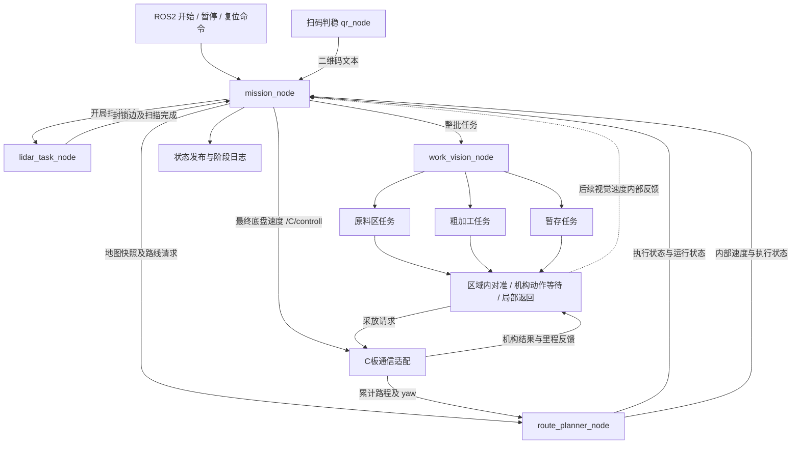

> 2026-10-26 历史文档说明：正文保留早期设计，不作为当前接口或运行指南。现统一为车体系前 vx / 左 vy、yaw 逆时针为正；桥接原样发送 vx/vy，正文中的交换轴表及旧坐标公式均不再使用。当前使用固定会话系二维里程，健康自动恢复，坐标变化终止旧任务。现行约定见 [车体坐标统一实施记录](车体坐标统一实施记录.md)，实操见 [实车测试操作指南](../C板实车测试操作指南.md)。

# 比赛调度节点设计方案

目录清理更新：开发测试、临时文件及模拟执行节点和启动入口已删除，当前保留比赛运行文件。正文模拟与测试章节仅作为历史设计和验证依据，当前运行方式见[比赛调度说明](../ros2_ws/src/agv_mission/README.md)。

日期：2026-10-22。状态：调度、接口、模拟及路线适配已实现；真实区域任务和硬件依赖待接入。

速度出口更新：mission仍只发送目标节点，起点与朝向由路径节点内部确定。路径节点通过 `/route/control` 返回带任务身份、时间和序号的RouteControl（速度及执行状态）；mission按当前任务过滤后统一维护 `/C/controll`。完成、中止、暂停及反馈超时归零，确认成功后推进阶段；纯模拟同样经过mission转发。后续区域视觉速度也按此出口接入。

实施更新：已新增 `agv_mission` 调度包、统一任务接口、纯软件模拟执行端，并扩展现有路线节点的运行查询、停止、复位和比赛身份隔离。使用方式与当前实现边界见[比赛调度说明](../ros2_ws/src/agv_mission/README.md)。以下正文保留设计依据；真实主相机整批业务、雷达识别、C板通信及二维局部返回仍为外部接入依赖。

验证更新：三个相关包构建通过；截至2026-10-22，逻辑、ROS集成、多进程launch和原有相机单元测试共21项通过，完整模拟确认十五阶段与24条机构程序。新增服务运行查询统一使用 `GetExecutorRuntime`，停止用 `StopExecutor`，复位用 `ResetExecutor`，三个执行端共用类型；这是第9节建议接口的实际实现名称。

## 1. 本次需求与设计结论

新增 Python ROS2 包 `agv_mission`，以 `mission_node` 作为整场比赛的唯一调度入口。

采用两层状态机：比赛层安排雷达扫描、区域间移动、扫码和六次区域整批作业；区域层负责本区域三个物料的具体执行。比赛层发出一次整批任务，等待结果，不重复下发区域内部的采放命令。

首版按完整实车比赛设计，先用模拟执行端验证流程，再逐项接入真实模块。实现目标是正常情况下完整跑通比赛；异常时停止推进，打印原因，保留现场，不实现自主恢复、自动重试或断点续跑。

### 1.1 用户已确认的行为

| 项目 | 本方案采用的规则 |
| --- | --- |
| 设计范围 | 完整比赛架构、完整任务接口，分阶段落地 |
| 区域调用 | 提交一次本批颜色和位置数组，区域模块完成整批 |
| 开始方式 | 当前使用 ROS2 命令模拟触发，实体按键以后接入同一入口 |
| 雷达 | 开始比赛后扫描，确认哪些道路不能走，再开始比赛移动 |
| 暂停 | 停止比赛推进和底盘运动；本轮不提供继续功能 |
| 暂停遇到抓放 | 已发出的当前完整机构动作安全完成，然后停止，不开始下一步 |
| 暂停后重新比赛 | 必须先复位，再开始 |
| 复位 | 软件清空状态；人工恢复车辆、物料和机构初始状态，不自动返回起点 |
| 异常 | 首版不自主恢复，不跳阶段，不把未知结果当作成功 |
| 程序重启 | 作为新一轮，从头开始，不读取旧进度续跑 |
| 调试日志 | 每次进入阶段打印阶段名称，重要子步骤和失败原因也打印 |
| 正常结束 | 回到启停区并停车后保持结束状态，不自动开始下一轮 |

### 1.2 与已有文档的关系

区域业务沿用以下最新规格，不重新设计视觉算法：

- [主相机简明执行流程](主相机视觉方案/简明执行流程.md)。
- [公共视觉与伺服约定](主相机视觉方案/00_公共视觉与伺服约定.md)。
- [原料区取料](主相机视觉方案/01_原料区取料方案.md)。
- [粗加工放料与取回](主相机视觉方案/02_粗加工区放料与取回方案.md)。
- [暂存平放与码垛](主相机视觉方案/03_暂存区平放与码垛方案.md)。

本次确认更新了旧总体指南中的异常策略：首版异常后不设计自动恢复或条件恢复续跑；暂停后必须复位重开。阶段编号沿用十五阶段，方便与现有文档及 `PlanRoute.stage` 对照，但业务逻辑使用命名枚举，避免依赖散落的数字。

## 2. 当前代码基础与必须补齐的缺口

本节保留实施前的源码盘点，用于解释新增接口的原因。当前实现状态以文首实施更新及比赛调度README为准。

| 部分 | 当前实际能力 | 对调度方案的影响 |
| --- | --- | --- |
| `agv_perception/qr_node.py` | 节点启动后扫码，连续 5 次同文本后发布一次 `/qr/result` 和 `/qr/center` 并关闭相机 | 首版可直接订阅文本，不必为了调度先改造成 Action |
| `/qr/result` | `std_msgs/String`，RELIABLE、VOLATILE、depth=1 | 暂存本轮提前收到的有效结果，扫码阶段保存快照并转发至 `/mission/qr_result` |
| `/route/plan` | `PlanRoute` Service；接受合法计划后自动执行 | 请求成功表示开始执行，不能直接切到下一阶段 |
| `/route/execution_status` | 携带 `request_id` 的 EXECUTING / COMPLETED / ABORTED / REJECTED | 只接受当前任务对应的终态 |
| 路线执行 | 根据累计路程和连续 yaw 向 `/route/control` 返回速度及状态 | 调度器校验当前任务后转发到 `/C/controll`，不重复计算速度或执行路线动作 |
| 路线取消/运行状态查询/跨轮复位 | 尚无相应服务 | 必须增加，才能兑现暂停、复位及重启后的可靠初始化 |
| 地图 | 整份 `BlockedEdges` 快照，版本为正且单调递增 | 新一轮必须同步清理规划器的旧地图，不能只清理调度器 |
| 工位朝向 | `planner.yaml` 中仍为 `UNSET` | 真机前必须配置，不能由调度器猜测 |
| 主相机区域任务、雷达任务、C板通信 | 业务接口尚未实现 | 先定义任务契约和模拟端，真实模式不伪造完成 |
| 局部返回 | 现有累计路程标量不足以提供二维返回 | 由区域/运动层补齐，调度只检查区域离站结果 |

另外，当前 `RoutePlan.end_heading` 是计划值；现有执行状态不带实际位置和 yaw。调度可以在对应 COMPLETED 后提交目标节点，但要获取真实朝向、执行器是否空闲、地图是否生效，仍需新增运行状态查询能力。

## 3. 模块职责与控制关系



### 3.1 总调度负责

1. 保存本轮身份、全局运行状态、当前比赛阶段及当前活动任务。
2. 解析和冻结二维码任务快照，生成两批数组及第一层颜色位置映射。
3. 按阶段请求路线、雷达或区域任务，检查结果后推进。
4. 保存已确认的区域步骤，供日志与状态显示使用。
5. 保证上一运动执行者释放控制后，下一执行者才接手。
6. 处理开始、暂停、复位以及异常停止。

### 3.2 总调度不承担的区域内部逻辑

目标识别、HSV/霍夫检测、物料判稳、像素伺服、逐件动作命令、等待C板结果、局部返回及离站精校准，都属于区域执行器。

区域执行器拥有执行中的物料索引。调度只提交其反馈的已确认记录，不维护另一套可以自行推进的索引，也不根据反馈自己发下一件采放命令。

C板继续负责完整采、平放、码垛及动作内部转仓。调度不增加仓盘角度、转仓命令或实际仓位状态机。

## 4. 两层状态的组织

将“比赛是否运行”和“当前做哪一步”分开保存。

### 4.1 外层运行状态

| 状态 | 含义 | 是否允许启动下一任务 |
| --- | --- | --- |
| `INITIALIZING` | 检查配置、查询执行端、清理遗留任务、建立本轮上下文 | 否 |
| `READY` | 初始化完成，等待开始命令 | 仅收到 start 后 |
| `RUNNING` | 正在执行开局扫描或比赛阶段 | 是，且必须通过当前阶段完成条件 |
| `PAUSING` | 已关闭推进权限，正在停车/取消/等待当前机构动作结束 | 否 |
| `PAUSED` | 所有执行端已停止，等待人工恢复及软件复位 | 否 |
| `FAULT` | 当前任务失败或结果未知，记录原因并请求执行端停止 | 否 |
| `RESETTING` | 所有旧任务已结束后，清理并重新初始化执行端和本轮数据 | 否 |
| `FINISHED` | 最后一条返回路线已完成并释放控制 | 否 |

正常流转：

```text
INITIALIZING → READY → RUNNING → FINISHED
                         │
                         ├─ 暂停 → PAUSING → PAUSED
                         └─ 失败 → FAULT

PAUSED / FAULT / FINISHED / READY
    → 在执行端已静止、无未决动作时接受 reset
    → RESETTING → READY
```

`PAUSED` 没有直接返回 `RUNNING` 的分支。`FAULT` 也不自动回到当前阶段重试。

`FAULT` 不等于已经停妥：状态另带 `quiescent` 和未决动作信息。只有执行端停止确认齐全，复位才能被接受；不能进入 FAULT 后立即清掉仍在运行的动作。

### 4.2 阶段执行子状态

每个比赛阶段使用简短的统一子状态：

```text
ENTER → REQUESTING → WAIT_RESULT → VERIFY_RESULT → COMPLETED
```

扫码阶段主要是 `WAIT_QR`，路线等待为 `WAIT_ARRIVAL`，区域任务等待为 `WAIT_BATCH`。它们是便于观察的子状态，不另外复制整套外层状态机。

进入阶段执行一次 `on_enter()`；后续只处理事件，不在定时器每次触发时重新发送请求。

## 5. 完整比赛阶段表

开局扫描用独立命名阶段 `STARTUP_SCAN`，发生在 start 之后、编号1之前。与路线接口对接时其编号用0；尚未进入比赛阶段时同时携带明确阶段名称，不能仅凭数字0解释为独立调试。

| 编号 | 名称 | 任务 | 推进条件 |
| --- | --- | --- | --- |
| 开局 | `STARTUP_SCAN` | 扫描封锁道路，提交地图 | 本轮扫描完成，雷达允许行驶，规划器确认同版本地图生效 |
| 1 | `MOVE_TO_QR` | 启停区 → 2 | 当前路线 COMPLETED 且执行端空闲 |
| 2 | `READ_TASK_CODE` | 读取二维码 | 合法任务码已保存为本轮结构化快照 |
| 3 | `MOVE_TO_RAW_1` | 2 → 4 | 当前路线完成 |
| 4 | `RAW_BATCH_1` | 第一批原料三次采料 | 三件完整采料及本次离站参考恢复完成 |
| 5 | `MOVE_TO_COARSE_1` | 4 → 6 | 当前路线完成 |
| 6 | `COARSE_BATCH_1` | 第一批三放、三取 | 六次完整动作及最终三空环精校准完成 |
| 7 | `MOVE_TO_STORAGE_1` | 6 → 8 | 当前路线完成 |
| 8 | `STORAGE_PLACE_1` | 第一批三次平放 | 三件完整平放、第一层记录及离站恢复完成 |
| 9 | `MOVE_TO_RAW_2` | 8 → 4 | 当前路线完成 |
| 10 | `RAW_BATCH_2` | 第二批原料三次采料 | 同原料整批完成条件 |
| 11 | `MOVE_TO_COARSE_2` | 4 → 6 | 当前路线完成 |
| 12 | `COARSE_BATCH_2` | 第二批三放、三取 | 同粗加工整批完成条件 |
| 13 | `MOVE_TO_STORAGE_2` | 6 → 8 | 当前路线完成 |
| 14 | `STORAGE_STACK_2` | 第二批同色码垛 | 三件完整码垛及离站恢复完成 |
| 15 | `RETURN_HOME` | 8 → finish_area指定停车区 | 当前路线完成、停车并释放控制，进入 FINISHED |

起点与最终停车区在mission YAML分别使用 `start_area / finish_area` 配置，值为 `left/right`，对应节点1/3；区域节点仍为二维码2、原料4、粗加工6、暂存8。

移动阶段从规划器已确认的实际节点出发，同时校验它是否符合正常阶段的预期起点。若二者不符，报告位置状态冲突，不通过强行填写 `start` 将车辆“改到”预期位置。

工位转向继续由规划器完成，路途中保持车头朝向、通过平移通行。需要作业的终点使用 `align_at_goal=true`，目标朝向来自配置；回启停区不额外要求朝向。首版不增加扫码位置精校准。

## 6. 比赛上下文与任务身份

建议用 `dataclass` 保存上下文，避免大量互不关联的成员变量。

| 数据 | 建议字段 | 用途 |
| --- | --- | --- |
| 本轮身份 | `run_id` | 初始化/复位生成新 UUID，隔离上一轮反馈 |
| 运行状态 | `mode, state, stage, substate` | 模式、外层状态及当前阶段 |
| 版本 | `context_revision, task_revision` | 识别状态快照及二维码快照 |
| 活动任务 | `task_id, task_kind, request_state` | 关联路线请求、扫描或区域 Action |
| 执行端身份 | `executor_session_id` | 识别执行节点是否中途重启 |
| 位置记录 | `home_node, confirmed_node, position_known` | 保存已确认节点，失败后标记未知 |
| 朝向 | `heading, yaw_deg, heading_known` | 来自运动反馈/执行端查询，不由路线计划冒充 |
| 地图 | `map_revision, blocked_edges, map_committed` | 保存本轮封锁道路及生效确认 |
| 任务码 | `raw_code, batch1_colors, batch1_positions, batch2_colors, batch2_positions` | 本轮不可变任务快照 |
| 暂存映射 | `planned_first_layer, confirmed_first_layer` | 区分计划位置和已经确认的第一层记录 |
| 步骤账本 | `confirmed_steps` | 保存区域上报的完整动作确认，按身份去重 |
| 停止信息 | `stop_reason, quiescent, pending_action` | 暂停/异常后的未决状态 |
| 时间 | `run_started_at, stage_started_at` | 耗时和日志，使用单调时钟计算间隔 |

身份分工：

- `run_id`：本轮比赛。
- `task_id`：一次路线、扫描或整批调用；路线使用相应的 `request_id`。
- `step_id`：区域内部某一个物料的某一次放/取动作。
- `visit_id`：区域模块记录本次进站观察位，禁止跨进站复用像素参考。

不持久化可续跑进度，不自动从日志还原比赛。日志可以落盘用于排查，但不参与重启后的执行决策。

## 7. 二维码处理

### 7.1 首版继续接现有话题

扫码节点启动后处理新帧，连续 5 次识别到同一文本后只发布一次结果并释放相机。先启动调度器并建立 `/qr/result` 订阅，再启动扫码节点。调度器从启动起订阅原始 VOLATILE 话题，暂存本轮在扫码阶段之前收到的首个有效任务码，在 `RUNNING + READ_TASK_CODE + WAIT_QR` 时冻结快照；暂停、故障及扫码之后的消息不作为候选。

首次有效结果写入任务快照并立即锁定。后续相同或不同二维码都不覆盖本轮数据，也不清零物料进度。下一轮必须复位、重启扫码节点获取新结果并重新经过扫码阶段。复位同时清除提前收到的候选。

不增加 `/qr/read_align` Action，原始 `/qr/result` 继续为 RELIABLE、VOLATILE、depth=1，避免历史扫码回放到调度。调度接受并保存本轮任务后向 `/mission/qr_result` 转发一次，类型为 `std_msgs/String`，使用 RELIABLE、TRANSIENT_LOCAL、depth=1，供晚加入订阅者读取最近一次接受结果。输入/输出分别可由 `qr_input_topic` / `qr_result_topic` 配置；转发缓存不作为调度输入，当前轮次与有效性以 `/mission/task_info` 的 `run_id`、`valid` 为准。

当前 `String` 没有采集时间和本轮身份。仅在阶段内接收、保持现有非持久化 QoS、使用小队列，可以避免主动复用旧缓存，但不能严格证明每条文本都采集于进入阶段之后。首版按现有接口接入；若需要严格采集边界，再增加带扫描身份的读取接口。`/qr/center` 不参与首版比赛推进。

### 7.2 校验规则

严格匹配四组三位数字，例如 `156+123+516+231`：

1. 颜色组每位为1～6，每组三个颜色互不重复。
2. 两批颜色集合相同，顺序可以不同。
3. 两个位置组均为1、2、3的排列。
4. 格式或跨组关系无效时不保存、不推进，打印节流日志，继续等有效读码。

颜色编号沿用红1、黄2、蓝3、绿4、黑5、浅蓝6。

### 7.3 示例任务展开

```text
二维码：156+123+516+231

第一批颜色：[1, 5, 6]
第一批位置：[1, 2, 3]
第二批颜色：[5, 1, 6]
第二批粗加工位置：[2, 3, 1]

第一层计划：1→1号位，5→2号位，6→3号位
第二批暂存位置：按同色第一层查询，得到 [2, 1, 3]
```

第二批暂存位置不能直接使用第四组 `[2,3,1]`。第一次暂存完成后，调度保存真实动作确认得到的第一层映射；第二次暂存只接受已确认完整的映射，不用计划映射冒充已落地状态。

## 8. 区域整批任务契约

### 8.1 接口选择

三个区域分别提供 Action 入口，统一使用新增 `RunWorkBatch.action` 类型：

| Action 名称 | operation | 业务 |
| --- | --- | --- |
| `/vision/raw/run_batch` | `RAW_PICK` | 按颜色顺序采三件 |
| `/vision/coarse/run_batch` | `COARSE_PROCESS` | 按颜色/位置顺序全放，再按颜色顺序全取 |
| `/vision/storage/run_batch` | `STORAGE_PLACE` | 第一批按位置平放 |
| `/vision/storage/run_batch` | `STORAGE_STACK` | 第二批按同色第一层码垛 |

它们由同一个 `work_vision_node` 管理主相机和忙碌状态，不为三个 Action 各开一个摄像头。

### 8.2 Goal 建议字段

| 字段 | 含义 |
| --- | --- |
| `run_id, task_id, task_revision` | 身份及二维码快照版本 |
| `stage, batch, operation` | 阶段、批次及本次作业类型 |
| `colors[3]` | 本批颜色顺序 |
| `positions` | 放置/预期底层位置；原料取料不用位置，明确传空数组 |
| `first_layer` | 第二次暂存所需的已确认颜色位置表；其他操作为空 |
| `enable_motion` | 是否允许真实运动；模拟端仍不得向硬件输出 |

不把 profile 准心、HSV阈值等所有视觉参数复制到 Goal；区域按 operation 选本地配置并保存配置快照。原料入口验证三个颜色，粗加工和暂存入口另验证三个位置以及映射一致性。

### 8.3 Feedback 建议字段

`run_id/task_id`、`operation`、`phase`、`item_index`、`step_id`、当前颜色/位置、已确认步骤、`motion_owner`、`arm_pending`、`reason`。

当前子状态可为 `WAIT_TARGET / ALIGNING / WAIT_ARM / RETURN_REFERENCE / FINAL_CALIBRATION`。调度用于打印和状态显示，不因为看到 `item_index` 变化而自行发送动作。

### 8.4 Result 与成功判据

结果建议包括：

```text
身份及任务版本
outcome：COMPLETED / FAILED / STOPPED / UNKNOWN
confirmed_steps：本批全部已确认动作记录
all_items_completed
reference_restored
motion_released
arm_idle
travel_ready
first_layer_records（仅首批暂存产生）
source：REAL / MOCK
reason
```

总调度只有在当前任务身份匹配、Action 成功结束、`outcome=COMPLETED`，且全部作业与离站条件通过时才推进。Action 终态和业务字段必须一致。

粗加工整批成功必须包含三放、三取、最终三空环位置与角度精校准。原料和暂存整批成功必须包含各自本次离站参考恢复。仅有 `aligned=true` 不满足整批成功。

按 `(run_id, task_id, step_id)` 提交账本，同一确认到达多次只记录一次。Result 应携带完整确认列表，不依赖每条中间 Feedback 都被订阅端收到。

控制器程序完成、视觉复核结果分别保存；没有传感证据时，不声称已验证实际抓取或裁判意义上的放置精度。

## 9. 路线接口的接入与必要扩展

### 9.1 保留规划并执行模式

继续使用 `/route/plan`，不重新实现规划算法或把每个离散动作交给 mission 执行。

路线调用流程：

1. 确认上一任务已释放底盘，当前节点/朝向可信，本轮地图已经生效。
2. 在本地先登记新的 `request_id` 和活动任务，再异步发起服务请求。
3. `plan.status=ok` 后保存计划、地图版本及目标，进入等待到达。
4. 收到同身份 COMPLETED 后核对运行状态，确认执行器已空闲。
5. 提交目标节点和最新朝向，检查仍处于 RUNNING，再推进阶段。

正常比赛请求优先使用 `start=0` 与空 `current_heading`，由规划器使用已确认节点和实时 yaw。不能为了消除报错每次强制设置起点，绕开位置未知检查。

### 9.2 必须补齐的运行接口

以下名称为计划中的新接口，均尚未实现。

| 接口 | 类型建议 | 作用 |
| --- | --- | --- |
| `/route/get_runtime` | `GetRouteRuntime.srv` | 查询空闲/执行中、活动任务、最新终态、节点/朝向可信度、最新 yaw、里程反馈健康、地图及执行节点启动身份 |
| `/route/stop` | `StopRoute.srv` | 针对当前身份停止路线，清除控制循环、发零，确认不再输出后返回 |
| `/route/reset_context` | `ResetRouteContext.srv` | 空闲时建立新一轮上下文，清地图和旧位置语义，重新同步初始节点、朝向和 yaw 基准 |

运行查询返回当前封锁边快照，或返回可验证快照内容的摘要；不能只凭“见过同一个版本号”就认为道路内容一致。执行状态还应能查询最近一项已接受任务的终态，供处理终态话题丢失。

建议在 `PlanRoute` 请求、`RoutePlan` 和 `RouteExecutionStatus` 中补充 `run_id`；执行端绑定当前比赛身份，拒绝旧轮迟到请求。现有 `request_id` 继续标识单次调用。接口变更须同时更新规划节点、说明和模拟端。

为独立调试保留阶段0，但运行模式与控制权必须显式区分：比赛模式只接受当前调度身份，调试模式才允许未关联比赛的请求。

### 9.3 暂停路线的语义

`stop` 仅对匹配的活动任务生效，避免旧取消请求停止新任务；重复停止同一任务应幂等返回已停止。异常初始化需要清理遗留任务时，先查询其真实身份再发停止请求。

路线中途被停止后，把位置标为未知；不能把上一拓扑节点或计划目标当作车辆实际所在点。因为本轮不续跑，该未知状态会一直保留到人工恢复现场、复位并重新同步。

发一条零速度不足以停止当前规划器：现有 `_tick()` 会继续输出非零速度。因此必须先停执行循环，再发零并确认释放控制。

### 9.4 异步时序与丢失结果

当前实现可能在 Service 返回前先发布执行状态，空路线还可能立即完成。因此预先登记身份；若状态先到，缓存给本次待决请求，等服务接受结果与状态共同确认后再处理。

服务响应超时不表示服务端未执行。处理方式是冻结推进并查询同一请求的运行状态，必要时停止；不能换一个新 ID 重发而制造重复移动。

执行状态不是持续心跳。任务尚在执行时，以里程健康和 `/route/get_runtime` 查询判断存活，不因一段时间没有新状态消息就认定执行端死亡。

## 10. 雷达与地图生效流程

新增 `/obstacles/scan` Action，建议类型 `ScanRoads.action`，输入本轮身份和任务身份；输出扫描结果、合法封锁边、地图版本及 `travel_ready`。

```text
start
  → 启动扫描
  → 扫描结果校验通过
  → 扫描机构恢复允许行驶的状态
  → 调度发布整份 BlockedEdges
  → 查询规划器，确认本轮版本和内容已生效
  → 进入 MOVE_TO_QR
```

首版扫描一次，得到整轮道路状态；不引入持续动态避障。若实际扫描不需要机械展开/收回，`travel_ready` 由雷达模块按实际设备给出，不凭空增加硬件动作。

空数组代表明确扫描确认道路全通；“没收到结果”不能解释为全通。

调度作为本轮地图快照的唯一提交者。复位时规划器也清理旧地图，并绑定新 `run_id`，以便本轮版本从1开始。避免规划器仍记着上一轮较大版本、拒绝新一轮地图。

`BlockedEdges` 当前也没有本轮身份，因此需要一并新增 `run_id`，规划器在比赛模式拒绝其他轮的地图。只给路线请求增加身份仍不足以阻止上一轮迟到的地图污染本轮。独立地图调试可在明确的调试模式使用空身份；查询地图生效结果时同时核对 `run_id`、版本和内容。

地图发布后、收到确认前，可以重发同版本同内容的快照；这是已有接口允许的幂等操作。当前规划器订阅为 VOLATILE，不能假设改发布端持久化就自动获得重连恢复。

雷达设备控制和封锁边识别算法属于雷达模块的后续实现，本方案定义调度所需契约与模拟端。

## 11. 开始、暂停和复位

### 11.1 命令接口

首版使用三个 `std_srvs/srv/Trigger` 服务，避免现在就引入按键或显示屏：

```bash
ros2 service call /mission/start std_srvs/srv/Trigger '{}'
ros2 service call /mission/pause std_srvs/srv/Trigger '{}'
ros2 service call /mission/reset std_srvs/srv/Trigger '{}'
```

这些是未来实现后的调用示例，目前尚不能直接使用。首版不提供 resume 或人工跳阶段入口。

命令服务短时返回“已接受”或“拒绝及原因”，实际完成通过 `/mission/state` 观察。尤其 pause 返回成功不代表机构已经完成或已经进入 PAUSED。

### 11.2 开始

仅在 READY 接受 start，先核对执行端空闲、必要接口、初始配置和运动依赖。初始化检查做静态校验，真正 start 前再检查动态状态；区域执行前还须根据二维码检查本批颜色配置。

调用 start 表示使用者已经把车辆、物料和机构恢复到本轮规定初始状态。软件无法通过清空变量完成物理复位。当前入口不增加另一道确认流程，未来实体按键复用此语义。

配置 `start_area / finish_area` 统一放在mission YAML。mission初始化/复位时通过reset_context同步起点及朝向基准给planner，最后一段使用finish_area的明确目标，不需要在planner YAML重复设置启停区。真实模式工位朝向未配置、执行端仍忙、机构状态未知等情况拒绝 start，并打印具体原因。

start 被接受后记录比赛开始时间，立即进入 STARTUP_SCAN。重复 start 不另建任务，不重置本轮数据。

### 11.3 暂停

第一步同步关闭“允许推进”标志，再发取消/停止请求，避免暂停与完成回调同时到达时发出下一任务。

| 暂停时正在做什么 | 执行要求 |
| --- | --- |
| 等扫码或尚未发任务 | 停止接受比赛结果，不再发新任务 |
| 路线行驶 | 停路线执行循环，底盘归零，位置标记未知 |
| 视觉对准、局部返回、最终校准 | 停止相应底盘控制，归零并释放控制 |
| 机构命令尚未真正提交 | 不允许再提交，直接停止本次任务 |
| 已提交完整采放程序 | 底盘保持停车，等待这一条完整程序及其内部转仓安全结束；不开始下一物料或下一次局部返回 |
| 雷达扫描 | 请求扫描模块停止/退出，等待设备进入允许静止待命的状态 |

区域取消采用“当前机构动作完成后退出”的语义。ROS Action cancel 的接受只表示已收到停止意图，不能立即把 Action 标成终态；应等待未决动作结束、底盘输出释放，再返回 canceled/STOPPED。

暂停请求与机构提交之间必须由区域内部同一个串行状态转换决定：已经被通信层接受的命令算未决动作；尚未接受的命令不能继续发出。提交结果不明时按未知处理，不擅自当作“没发出”。

当前完整机构程序按现有区域文档包括内部转仓；等其结束后，不再额外发一条归位、采放或返回观察位命令。机构程序本身有危险或执行失败时由C板保护处理，总调度不假设它一定能成功完成。

PAUSING 中仍接收当前动作结果，用来确认停止并更新诊断记录，但绝不推进阶段。所有执行端都确认停止后进入 PAUSED。机构结果超时或断联则进入 FAULT，标记未决状态；不能用固定延时宣称暂停完成。

### 11.4 复位

运行中调用 reset 直接拒绝，并说明先 pause；PAUSING 期间也不接受复位。PAUSED、FAULT、FINISHED、READY 仅在执行端已静止且没有未决机构动作时接受 reset。

复位顺序：

1. 冻结新任务入口，校验执行端全部空闲。
2. 废弃旧轮身份，生成新的 `run_id`，进入 RESETTING。
3. 清理调度的二维码、地图、步骤账本、映射、活动请求、计时和错误信息。
4. 调用执行端的上下文复位，清理旧区域任务、图像目标、局部参考和区域高度上下文。
5. 清规划器地图、失效旧路线，并基于人工恢复的起始姿态重新建立节点/朝向和 yaw 参考。
6. 所有执行端确认新身份、空闲及初始化完成后，进入 READY。

复位操作在各执行端采用身份校验及幂等 reset 标识，迟到的旧轮复位不能重置新轮正在执行的任务。初始化失败就停在故障状态，不因为部分执行端已经清空便宣称复位成功。

复位不让底盘自动回起点，也不自动恢复仓内物料。累计里程不必清零；若C板重新开始累计，规划器必须在空闲初始化时同步清掉旧单调性检查基线，不能把合法的新轮复位误判为执行中里程回退。

### 11.5 程序重启

mission 重启后生成新轮身份，不恢复旧阶段，不沿用旧二维码或旧地图。若其他执行节点还活着，先查询和结束其遗留任务；已发机构动作仍按安全完成策略处理。

只有清理结束、人工恢复初始现场并重新初始化后才允许新 start。“调度器重启”本身不能证明其他进程和硬件已经停止。

真实系统中调度进程意外退出到再次启动之间的停车，需要执行端的调度租约/心跳失效机制与C板速度超时配合；这是实车接入要求，不能靠重启后的清理覆盖这段时间。底盘失去有效控制即停车，已提交机构动作按控制器契约安全结束，不开始后续步骤。

## 12. 异常处理与超时

首版只实现可解释的停止路径，不实现恢复策略树。

| 情况 | 处理 |
| --- | --- |
| 无效二维码 | 留在扫码等待，节流打印拒绝原因 |
| 区域暂时看不到目标 | 由区域保持 WAIT_TARGET 且底盘停车；超出该区域配置时限后返回失败 |
| 无路、区域参数错误、离站参考未恢复 | 不推进阶段，进入 FAULT |
| 路线执行中止 | 停车、位置未知，进入 FAULT |
| Action 被拒绝或结果不完整 | 记录原因，进入 FAULT |
| 请求响应超时、连接断开 | 查询当前任务，未确认前按结果未知处理，不重发运动请求 |
| 机构结果未知 | 禁止新任务及复位放行，等待状态明确或外部完成机构重新初始化 |
| 执行节点中途重启 | 检测启动身份变化，冻结推进并进入 FAULT |
| 来自旧轮/旧任务的结果 | 忽略并记录诊断，不影响当前任务 |

通信超时、目标等待时限、动作结果时限在 YAML 中独立命名；不编造通用秒数。真实模式由对应设备标定，尚未配置时拒绝相关运动任务。模拟时间则单独配置，不能复用为真机完成判据。

不默认增加“比赛总时间到自动终止”的规则，本版只统计耗时；如以后要对接裁判计时或强制结束，再单独扩展。

## 13. 底盘控制权与静止确认

通过顺序任务和mission统一速度出口实现单一运动控制者，不增加独立仲裁节点：

1. 路线和区域任务不得重叠活动；共享主相机节点拒绝并发区域 Goal。
2. 执行端只向内部话题反馈，最终 `/C/controll` 只能由mission发布。
3. 任务完成或停止时，原执行器返回零速度、停止计算，再报告 `motion_released`；mission清除旧速度并归零。
4. 调度确认释放、机构允许行驶，再交给下一执行者。导航反馈丢失超过配置时限即故障停车。
5. competition 模式执行端只接受当前调度身份，不接受调试客户端插入运动任务。

mission在待命、暂停、故障及没有有效控制任务时维护零速，运动时即时转发当前任务新鲜反馈，不反复重发缓存中的非零速度。暂停仍调用执行端停止接口，不能只依靠输出归零。板间通信和C板仍需实现速度新鲜度检查，以处理mission进程退出。

软件停止发布并不等于物理静止：真实运行的 `travel_ready/quiescent` 还依赖底盘和机构反馈。反馈缺失时不冒称已经完成安全交接。

## 14. 代码组织

```text
ros2_ws/src/
├── agv_mission/                         # 新增 Python 包
│   ├── agv_mission/
│   │   ├── mission_node.py              # ROS服务、订阅、Action客户端、状态发布
│   │   ├── state_machine.py             # 串行事件处理和外层状态流转
│   │   ├── stages.py                    # 十五阶段枚举、目标节点、任务构造
│   │   ├── context.py                   # 本轮上下文、活动任务、确认账本
│   │   ├── task_code.py                 # 二维码解析、校验、映射生成
│   │   └── clients.py                   # 路线、区域、雷达客户端及超时处理
│   ├── config/mission.yaml
│   ├── launch/mission.launch.py
│   ├── setup.py / setup.cfg / package.xml / resource/
│   └── README.md
├── agv_interfaces/                     # 扩展统一消息、服务、Action
├── agv_planning/                       # 扩展运行查询、停止和上下文复位
└── agv_perception/                     # 后续实现区域整批Action
```

新增消息建议包括 `MissionState`、`MissionTaskInfo`、`WorkStepRecord`、`FirstLayerRecord`；新增 Action 为 `RunWorkBatch`、`ScanRoads`，以及路线运行服务。已有路线和地图消息补充本轮身份。执行端上下文初始化、查询与停止契约应覆盖雷达和区域模块，具体共享类型在实现接口时合并，避免给每个区域复制一套消息。

首版不引入 SMACH、行为树或另一个状态机框架。当前固定流程用枚举、阶段定义表、显式转换和事件队列即可表达；以后真的出现复杂分支再评估框架。

### 14.1 事件处理方法

ROS 回调负责校验、产生事件；由单一串行状态机更新上下文。Action/Service 使用异步客户端，不在回调中 `sleep()`，不使用阻塞循环等待物理动作。

示意代码：

```python
def enter_stage(stage):
    assert context.state == RUNNING
    assert context.active_task is None
    task = build_task(stage, context)
    context.active_task = task       # 先登记，避免先到的状态丢失
    log_stage_enter(stage, task)
    dispatch_async(task)

def handle_task_result(event):
    if not matches_active_identity(event):
        return
    commit_confirmed_steps_once(event)
    if context.state in (PAUSING, FAULT):
        update_stop_confirmation(event)
        return                      # 可以记结果，不能再开下一阶段
    if context.state != RUNNING:
        return
    if validate_complete_result(event):
        finish_current_stage_once()
        schedule_next_stage_or_finish()
    else:
        enter_fault(event.reason)
```

任务终态只能消费一次。完成事件和 pause 命令使用同一状态更新通道；处理 pause 时先关闭推进权限。所有未来回调还要检查本轮身份，避免复位后的旧 Future 影响新上下文。

## 15. 配置与运行模式

`mission.yaml` 使用原生 ROS2 参数结构，配置启动时读取；首版不做比赛中热更新。

```yaml
mission_node:
  ros__parameters:
    mode: mission_mock             # mission_mock / integration / competition
    start_area: left
    finish_area: left  # 最终停车区；left为1、right为3，与起点独立设置
    state_publish_rate_hz: 2.0     # 仅状态发布，不是底盘控制频率
    log_stage_entry: true
    log_region_step: true
    mock_task_code: "156+123+516+231"
```

其他配置分为执行端名称、依赖检查时限、接口响应时限、模拟场景配置和已有工位配置引用。真实动作时限由区域/C板配置负责，mission 不再维护另一套互相矛盾的机构时间。

| 模式 | 执行来源 | 输出限制 |
| --- | --- | --- |
| `mission_mock` | 雷达、路线、二维码和区域均为模拟 | 不启动真实底盘/机构执行端，不发布真实硬件控制 |
| `integration` | 在启动配置中逐项指定真实或模拟来源 | 明确记录来源，启用真实运动须显式配置，不能作为实车比赛完成证明 |
| `competition` | 全部必需结果来自真实模块 | 拒绝模拟结果，依赖不齐不开始，不偷偷转为模拟成功 |

模式固定在本次启动配置中，不通过运行中参数临时切换。模拟端和真实端同一接口只能启动一个；通过统一启动文件及命名空间避免同名服务或Action竞争。

`mission_mock` 的短延时仅代表模拟设备完成，模拟端仍须遵守任务身份、先后顺序和暂停语义。调度核心不写 `if mock: s += 1` 这种绕开真实契约的分支。

## 16. 调试输出

默认控制台只打印状态变化，不逐帧刷屏。例如：

```text
[MISSION] READY run=... home=1
[MISSION] STARTUP_SCAN 开局雷达扫描
[MISSION] MAP_COMMITTED revision=1 blocked=[(2,5)]
[MISSION] ENTER 01/15 MOVE_TO_QR 启停区→二维码区 task=...
[MISSION] DONE 01/15 elapsed=...
[MISSION] ENTER 02/15 READ_TASK_CODE 扫码
[MISSION] TASK_CODE_ACCEPTED 156+123+516+231
[MISSION] ENTER 06/15 COARSE_BATCH_1 第一批粗加工
[MISSION] STEP batch=1 PLACE item=1 color=1 position=1 CONFIRMED
[MISSION] STEP batch=1 PICK item=1 color=1 position=1 CONFIRMED
[MISSION] PAUSING phase=WAIT_ARM 等待当前机构动作结束
[MISSION] PAUSED 必须复位后才能开始新一轮
```

`/mission/state` 发布外层状态、阶段、子状态、活动任务、批次、已确认进度、故障原因、是否已静止及耗时；推荐 RELIABLE、TRANSIENT_LOCAL、depth=1，便于晚打开的观察终端获取当前状态。

`/mission/task_info` 发布结构化任务快照及 `run_id/valid`；复位时发布新轮 `valid=false`，覆盖上一轮持久化快照。状态持久化仅是节点存活期间的最近值缓存，不是断点恢复。

计划中的观察命令：

```bash
ros2 topic echo /mission/state
ros2 topic echo /mission/task_info
ros2 topic echo /route/execution_status
```

## 17. 实施顺序与每步交付

### 第一步：实现纯比赛逻辑

新增 `agv_mission` 基础包，完成阶段表、上下文、二维码解析、映射、单次进入/完成机制及日志。先验证状态流转，不引入真实运动。

交付：可以通过事件驱动观察完整阶段顺序；非法或旧任务结果不能推进。

### 第二步：定义任务接口并跑通全模拟

在 `agv_interfaces` 实现消息、Action和服务契约；mock 执行端实现扫描、地图确认、路线、区域整批和停止语义；接上 start/pause/reset。

交付：从 start 扫描到回起点 FINISHED 的完整模拟；暂停后必须复位才能重开；不会向硬件话题发运动/机构命令。

### 第三步：扩展并接入现有路线节点

补齐路线运行查询、停止、跨轮复位和本轮身份校验，处理终态先到、响应丢失、地图版本及空路线。接入累计里程/yaw模拟反馈，验证现有规划执行逻辑与调度配合。

交付：路线接受不提前推进；中途暂停确实停止规划器控制循环；第二轮地图和初始状态正确。

### 第四步：接入真实扫码与雷达契约

扫码优先复用现有 `/qr/result`。雷达先按统一 Action 接口实现模拟或适配端，真实扫描算法由雷达模块完成；完成后替换对应模拟来源。

交付：二维码正确转成两批数组；扫描生效前不会请求第一条比赛路线。

### 第五步：接入区域整批任务

先原料，再粗加工，再暂存两种模式。主相机节点独立实现区域内部流程，调度只替换客户端连接。板间通信必须先具备区域同步、动作身份和完整结果关联；局部返回及离站参考依赖必须齐全。

交付：真实整批完成条件成立才离站；第一层确认映射正确传入第二批码垛。

### 第六步：完整实车联调

填写真实工位朝向、相机及局部运动标定，接入C板里程/机构反馈、执行端失联停车机制；运行 competition 模式核对全部任务及暂停复位流程。

交付：具备从头到尾实车比赛条件。仅完成前两步时，应称为“比赛调度模拟跑通”，不能称为实车比赛完成。

## 18. 验证与验收

以下为设计验收清单；目前已完成软件逻辑、模拟和ROS多进程验证，物理停车、机构动作及离站精度仍需真实模块与实车确认。

| 验证场景 | 验收结果 |
| --- | --- |
| 标准全模拟 | 顺序为1次开局扫描、8条区域间路线、1次扫码、6次区域整批，最后 FINISHED |
| 区域内部动作统计 | 两次原料共6次采，两次粗加工共12次放/取，两次暂存共6次放置，总计24条完整机构程序；调度不重复发送 |
| 示例任务码 | 第二批粗加工位置 `[2,3,1]`，第二批码垛位置 `[2,1,3]` |
| 非法任务码 | 不保存、不推进，不生成默认任务 |
| 旧轮/旧任务/重复结果 | 不错误推进、不重复记账、不重复执行动作 |
| 路线状态先于响应 | 正确关联，不丢失即时完成，也不提前推进 |
| 路线响应或终态丢失 | 查询同身份状态，不重发未知执行结果的路线 |
| 暂停发生在路线中 | 执行器停止持续输出，位置未知，PAUSED 后 start 被拒绝 |
| 暂停发生在抓放中 | 只完成已提交的当前程序，不发下一动作，不局部返回，不推进阶段 |
| 暂停与任务完成并发 | 暂停被处理后不再派发下一任务 |
| 动作状态未知 | 不宣称已静止，不允许软件复位后直接重开 |
| 第二轮复位 | 二维码、地图、区域引用、步骤账本清理完整；旧轮消息不能重新污染 |
| 调度或执行端重启 | 不续跑旧阶段，清理遗留任务，重新同步后从新轮开始 |
| 模拟/真实模式隔离 | mock 无真实控制输出，competition 拒绝模拟结果 |
| 正常终点 | 必须回启停区路线完成并释放控制才 FINISHED，不自动循环 |

对纯逻辑和身份时序使用有针对性的自动化测试；对ROS异步接口做模拟集成测试；对物理停车、机构完整动作和离站参考做实车验证。无需为了日志文本或简单配置增加逐行对应的测试。

## 19. 范围边界与后续实现依赖

需求层面已明确，无需再猜测比赛顺序、区域执行权、暂停语义或重启行为。以下属于实施时需要补齐的模块和标定，不擅自填值：

- C板通信协议、机构反馈与区域同步确认格式。
- 区域内部二维返回能力、动作期间是否允许运动的真实反馈。
- 真实工位朝向、离站参考、相机/HSV与控制参数。
- 雷达封锁道路识别及扫描设备退出流程。
- 执行端在调度掉线时的停车/保持机制。

本次不开发自主恢复、暂停续跑、断电续跑、自动返回式复位、显示屏、实体按键或持续动态避障。当前已交付调度节点、统一接口、模拟执行端及路线适配；第17节涉及的真实区域业务和硬件算法继续按各模块规格接入。
